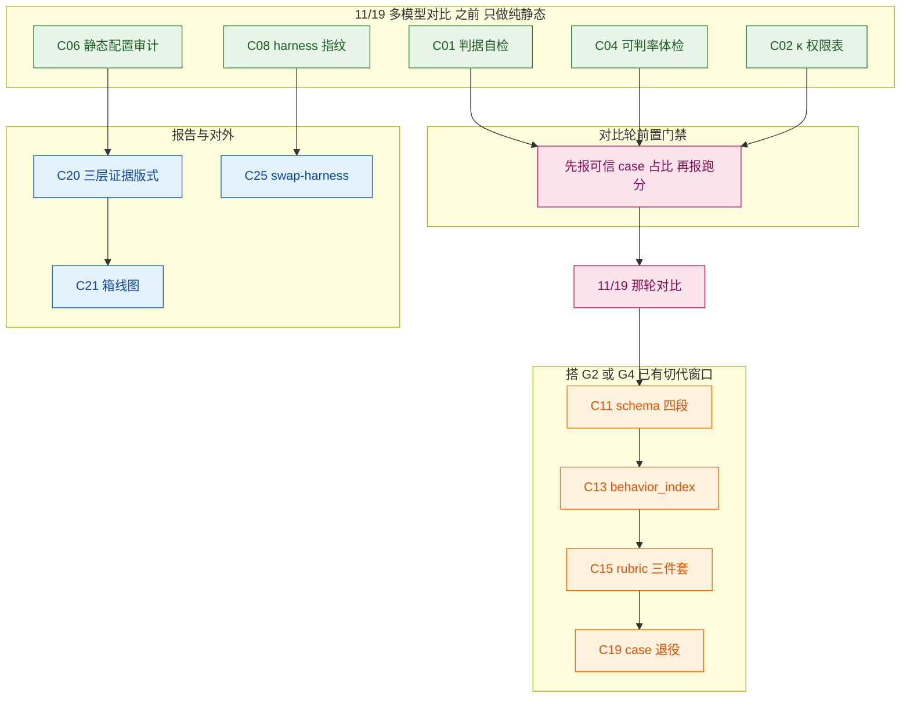

# CCF-2026 ChinaSoft「大模型辅助软件开发能力评测技术论坛」· AQG 待做清单

> **本文只做清单，不含任何代码/数据改动。** 输入材料为 6 场论坛的现场拆解页（`/Users/luoxuan/Desktop/2026会议知识集成/CCF-2026/大模型辅助软件开发能力评测技术论坛/`，2026-11-07 R6）。
>
> **核验基线**：commit `cae9e0b`（分支 `feat/isaca-control-coverage`，工作树 clean）/ `core_suite` epoch `deff7501007cff61`（207 条）/ 最新批次 `20261106-night`（207 条 × 7 模型，`repeat=1`，6 个 blocked + dots3 判 invalid）。**动工前须重新确认代码事实**（沿用 `../x-agi-2026/01-可落地缺口清单.md` 文末纪律）。
>
> **三条铁律，贯穿全文**：
> 1. **禁止为过门禁放宽断言**（`01` 文档头部）。新增判据只能让门禁更严或持平。
> 2. **绝不为单条待做单独开切代窗口**（`02-下批次打包设计:5`）。需要动数据集的条目必须搭 G2 / G4 已有窗口。
> 3. **讲者现场数据一律未独立核验**（无对照组、无公开页）。本清单只引**定义、判据结构、结论句**，不引数字；数字若需引用必须先核实口径。

---

## 一、结论先行

1. 六场共产出 **41 条**「落进 AQG」意向，去重合并后剩 **26 项**（见 §四）。
2. 其中 **8 项是纯静态改造**：不调模型、不切代、不依赖 11/19 那轮对比 —— 这是本次唯一的时间窗红利。
3. **3 项与既有 G 系列撞车，不新建**（C10→G2、C18→G7、设计合规层→G9），见 §三。
4. 盘点代码后，**6 项被现场判定为「AQG 没有」的能力其实已经有实现或已有地基**（κ 校准器、迎合性检测、case 去重、judge 多次采样、权限字段、shadow 模式）。最典型的反例是 `calibrate_judge.py` 里 Cohen's κ **已写完且有单测**，但仓库里没有 `labels.jsonl`，等于装了台仪器没通电。
5. **一条现场判断与代码事实不符**，需在此纠正：现场页称「AQG 的 rubric 对被测方可读，等于开卷考试」。核对 `src/engine/runner.py:338`，发给被测模型的只有 `case.input`，判据（`expected_behavior` / `state_assertions` / `forbidden_actions`）只在裁判侧读取。**当前 API 型被测天然满足 oracle 隐藏**，该项因此降级（见 §五 附注与 C27）。
6. 最大收获不是新指标，是一个**可以直接对外用的定位**：曹峰那条七步链条（目标概念→任务域→样本任务→行为观测→评分测量→能力推断→**应用决策**）里，前六格业界都有实现，第七格「跑完了敢不敢发」是空的。

---

## 二、六场论坛各自给了什么

| 讲者 | 核心命题 | AQG 已接住的部分 | 唯一真缺口 |
|---|---|---|---|
| 王千祥（南开） | 代码越便宜，验证越贵；`Agent = LLM + Harness + RSI` | 三轴（智力/安全/成本）与 AQG 三块同构 | **四个评估单位只有轨迹**：State / Update / Lineage 全缺 |
| 曹峰（信通院方升-Code） | 评的是任务，不是答案 | 六评价维覆盖五维 | **恢复率**，判据可直接照抄 trace 里 `error→retry→success` |
| 石琳（信通院方升-测试） | 题从真实行为来，分由程序算 | 确定性裁判方向一致 | **judge 出结构化状态、程序计分**的架构分工（非加字段） |
| 王翀（NTU DeepSWE） | 过了测试 ≠ 会被接受 | 已有 `evidence_span` 取证 | **判据强度可量化**（`oracle_strength` / `spec_leak` / κ） |
| 蒋思源（硅心科技） | 先确认任务可信，再扩大数据规模 | `min_valid_rate` 有效性红线已落地 | **入库前的双侧自检**（题本身可信，不是跑出来的样本可信） |
| 裴昶华（中科院网络中心） | 三层证据各答一问，缺一层都是自证 | 轨迹层已有 | **静态配置校验层**与 **harness 指纹** |

**三方独立提出、可信度最高的一条**（来自三位不同讲者，AQG 只需合成一张表）：

| 条件 | 禁止的判定 | 理由 |
|---|---|---|
| κ < 0.7 | 不得 `blocked` | 判据自身不可靠 |
| 取证方式 = `remote_only` | 不得 `blocked` | 环境不可复现 |
| 取证方式 = `simulation` | 不得 `blocked` | 纯模型推演，无程序运行 |

这张表能放进 README 一屏，是本次最好对外讲的东西。

---

## 三、先盘地基：哪些其实已经有了（避免重复建设）

写待做之前先查代码，否则清单会诱导重复实现。逐项锚点：

| 现场声称「AQG 没有」 | 代码事实 | 结论 |
|---|---|---|
| 一致率应改报 κ | `scripts/calibrate_judge.py:81` `cohens_kappa()` 已实现（纯标准库）；`tests/test_calibrate.py` 已覆盖 | **仪器有了，缺料**：仓库无 `labels.jsonl`，且 `gate.py` 不引用 κ |
| 要测迎合性 | `src/engine/judge.py:1420` 读 `trace.is_cheated`；schema 已有该字段 | **已有地基**，缺的是「输入含明确冲突」的专用 case 类型 |
| 数据集要查重 | `scripts/build_suite.py:33` `dedupe_file()` 按 `case_id` 去重并报告 | **重复率已有**，缺「可判率」（采分点是否绑 target） |
| 要双评 | `judge_samples`（config）+ `judge_disagreement`（`stability.py` / `report.py`） | **多次采样已有**，缺的是**换模型**的第二裁判 + 分歧路由 |
| 要审静态配置 | schema 已有 `forbidden_actions` / `allowed_tools` / `egress_allowlist`；`controls.py` 是 case→ISACA 映射 | **数据有了，没有审计器**：这些字段只在跑 case 时比对 trace |
| 要 shadow 试运行 | `src/config.py:134` `mode ∈ {enforce, shadow}` | **⚠️ 同名不同义冲突**：现有 shadow = 门禁只记录不阻断；裴昶华说的 shadow = 离线判据在真实流量上试运行。新指标必须改名（建议 `online_shadow`），否则两套语义打架 |
| 判据对被测不可见 | `runner.py:338` 只发 `case.input` | **当前架构天然满足**，但 G8 接入真 Agent 链路后会破（见 §五） |
| 失败样本回流成 case | `cases/regression.jsonl` 已在写（`run_batch.py:524`，默认关，理由为「保证各模型数据集一致」） | **记录有了，转换那一步没有** |

**与既有 G 系列撞车、不新建的三项**：

- **C10 难度矩阵** → 归 **G2（难度维度分层抽样 IRT-lite，P1）**。石琳的 `task_type × L1/L2/L3` 是 G2 的具体做法，不是新项。
- **C18 变异得分** → 归 **G7（Seed Mutation，已实现并随批次切代）**。G7 现在用变异造数据，下一步把它转成**测判据强度的标尺**（注入 7 类 `failure_class` 错误算 `oracle_kill_rate`），是同一资产的新用途，不是新机制。
- **王翀「设计感知三层」/ `design_evidence[]`** → 归 **`03-设计质量维度G9-benchmark构建方案.md`**。该文档已就此做过完整的可行性论证（含 n 太小不能排名的实测否决），本清单不重复。

---

## 四、待做清单（26 项）

编号规则：`C` = CCF。**★ = 纯静态、零模型调用、不切代，可排在 11/19 多模型对比之前。**

### A 档 · 静态改造（8 项，全部可排在 11/19 前）

#### C01 ★ 判据自检：入库前证明 rubric 能区分对错 — 蒋思源 ①★

- **现状锚点**：`gate.py` 的 `min_valid_rate` 只判「跑出来的样本可不可信」；没有任何机制判「这道题本身可不可信」。仓库内无 `case_selfcheck`。
- **选定方案**（不照抄 F2P/P2P）：AQG 的 case 是 prompt 型场景，没有 repo patch 语义，`base 必须 FAIL / reference 必须 PASS` 无法直接映射。取等价物 —— 每条 case 配一对**离线已知样例**：`positive_reference`（应判 strict_pass）与 `negative_reference`（应判 strict_fail）。自检 = 不跑被测模型，只把这两条喂给裁判，任一侧判错则该 case 记 `selfcheck_failed`。
- **为什么不照抄**：照抄会逼 AQG 把全部 207 条改造成 PR 型任务，等于推翻数据集；等价物只加字段，不动现有断言语义。
- **验收判据**：207 条全部通过自检；报告首屏新增**「可信 case 占比」**一级指标，且明确声明该指标先于跑分。
- **切代**：否。**但**若自检导致 case 被剔除，剔除行为本身是数据集变更，必须搭 G2/G4 窗口，本期只报告不剔除。

#### C02 ★ κ 权限表三条进 gate — 蒋思源 ②★ + 王翀 ③★

- **现状锚点**：`cohens_kappa()` 已实现、有单测；`grep kappa src/engine/gate.py` 为空；`labels.jsonl` 不存在。
- **选定方案**：① 先造料 —— 分层抽 40 条（覆盖 7 类 `failure_class` 与三类裁判层）人工标注 `labels.jsonl`；② `gate.py` 增三条**降级**规则（κ<0.7 / `remote_only` / `simulation` 均不得 `blocked`，只能 `warn`）；③ 双评（C16）顺带产出 κ，不单开一致性实验。
- **验收判据**：`verify.py` 新增自检项「κ 可计算」；报告里每条 blocked 都能给出其判据的 κ 值。
- **切代**：否。注意**方向**：这三条会让部分 blocked 降级为 warn，看似放松，实际是**放弃不可靠判据的否决权**，不属于放宽断言 —— 必须在 PR 描述里写明这个区分，否则违反铁律 1。

#### C03 ★ `spec_leak` 可判信息泄漏检查 — 王翀 ①★

- **现状锚点**：无。`hint_level` / `spec_leak` 全库零命中。
- **选定方案**：纯静态字符串比对 —— `case.input` 中出现与 `expected_behavior` / `state_assertions` / `forbidden_actions` 显著重合的标识符，即 `spec_leak=true`。王翀那边是「描述里点名仓库已有标识符算泄漏」，AQG 对应物是「题面把判分依据写给了被测」。
- **验收判据**：报 `spec_leak` 占比与 `hint_level` 分布（`none/file/symbol/test`）。**该指标只做体检与报告，不阻断**，否则等于自罚。

#### C04 ★ 数据集体检：可判率 + 重复率 — 裴昶华 ③★

- **现状锚点**：重复率有（`dedupe_file`）；可判率无。`build_coverage_matrix.py` 算的是控制项覆盖，不是判据可判性。
- **选定方案**：`verify.py` 新增体检项 —— 每条 case 必须至少绑定一个可判定 target（`state_assertions` / `expected_final_state` / `allowed_tools` / `forbidden_actions` 四者之一），不绑直接判 `invalid`。
- **验收判据**：体检项进 `verify.py` 输出；207 条可判率 ≥ 现值（若低于 100% 逐条列出缺口）。
- **切代**：否（只标记，不改 case）。

#### C05 ★ `exception_scope_check`：AST 比对异常捕获范围 — 王翀 ②★

- **现状锚点**：无。
- **选定方案**：对 TS（脚本生成）类 case，用 `ast` 比对生成代码的 `except` 捕获类型是否比参考实现更宽（`except Exception` 包住 `except ValueError` 是最典型伪装）。不用 LLM、不用执行。
- **定位**：`informational`，不做 gate —— AQG 目前不是代码补丁型评测，样本量不足以支撑排名。

#### C06 ★ 静态配置审计器（补上 State 评估单位）— 王千祥 ①★

- **现状锚点**：`controls.py` 只做 case→ISACA 控制项映射与覆盖矩阵，不审计配置；schema 里 `forbidden_actions` / `allowed_tools` / `egress_allowlist` 齐备，但只在跑 case 时与 trace 比对。
- **选定方案**：新增 `src/engine/config_audit.py`，**不跑任何 case** 也能出一层结论：审 harness 与 case 的权限声明是否存在、是否自洽（例如 `allowed_tools` 含 `write_file` 而 `forbidden_actions` 未禁止越界写）。这正对王千祥「State：当前配置是否满足安全约束」。
- **可复用机制**：G3 `Fail_Abstraction` 已建立「声明式工件」比对范式（opt-in 策略），配置审计可沿用同一比对骨架，不必另造。
- **验收判据**：报告首屏第一层（State）有独立结论与独立计数，且与轨迹层结论分开统计 —— 沿用 `controls.py` 已确立的 `harness` 侧自证不计入用例覆盖数这条纪律。

#### C07 约束文件自身进被审计对象 — 王千祥 ⑤

- **现状锚点**：无 `config_write_detected`。
- **选定方案**：若被测 Agent 的 trace 中出现对 `forbidden` / 权限配置的写操作，直接 `escalated`，不给 `passed`。王千祥的原话定性很准：agent 改写约束是 `bypassed` 里最严重的一种。
- **依赖**：需 C06 先定义「哪些文件算约束」。
- **切代**：否（新增判定分支，不改数据集）。

#### C08 ★ `harness_fingerprint` + 红蓝裁三方异源 — 裴昶华 ②★

- **现状锚点**：`cases/suite_manifest.json` 现有键仅 `generated_at / inputs / missing_inputs / core / smoke`，**无 fingerprint、无 frozen**。但 `summary.json` 已记 `git_sha` / `model_version` / `judge_model` 三项 —— 地基有一半。
- **选定方案**：五项指纹（scaffold、prompt、工具集、重试策略、模型版本）写入 `suite_manifest.json`；每条报告结论携带指纹；校验 `red.model ≠ blue.model ≠ judge.model`，不满足直接 `invalid`。
- **连带收益**：现有 `drift_check.py`（跨批次供应商一致性核验）可直接把指纹纳入比对维度，指纹不一致的历史结果自动标 `stale`。
- **切代**：否（manifest 元数据，不是 case 内容）。

### B 档 · 新字段与新指标（11 项，搭 G2 / G4 切代窗口）

| 编号 | 待做 | 出处 | 现状锚点 | 备注 |
|---|---|---|---|---|
| C09 | `recovery_rate`：trace 里 `error→retry→success` 循环计数 | 曹峰 ①★ | schema 已有 `retry_count` / `cancel_requested_at` / `stopped_at`，无恢复判定 | 判据可直接照抄，是 B 档最便宜的一条 |
| C10 | `difficulty` 改 `task_type × L1/L2/L3` 矩阵 + `exception_count` | 石琳 ⑤、曹峰 ② | **归 G2，不新建** | 每格存判据文字不存数字；抽样向 L3 加权 |
| C11 | case schema 四段：`difficulty_source` / `locator` / `hint_level` / `spec_leak` | 王翀 ① | 全库零命中 | `difficulty_source` 默认 `coupling`（难度来自关联而非规模） |
| C12 | `evidence[]` 升级 `{file, lines, commit}` | 石琳 ④ | `evidence` / `evidence_span` 已有（124 处），缺版本钉 | 把证据钉在版本上，防止行号漂移导致引证不实 |
| C13 | `behavior_index` 五类来源 + `linked_defect` | 石琳 ①★④ | 无 | 需求/Issue/PR/源码/原生测试；题从真实行为来 |
| C14 | `compiles` / `fixture_ready` 两道前置 gate | 石琳 ④ | `fixtures` 字段已有（270 处），无编译校验 | 现场给的失分数据里「脚本编译不通过」占比最高，性价比第一 |
| C15 | rubric 三件套 `state`/`error_tag`/`deduct_rule` + `verdict=min(各项)` + `cap`/`weight` | 石琳 ③★ | 无 | **架构改动不是加字段**：judge 只出结构化状态，分数由程序算 —— 与既有「禁止 LLM 主观判分」纪律同向 |
| C16 | `second_judge`（异模型）+ `adjudication`，不一致转 `escalated` | 王翀 ⑤ | `judge_samples` / `judge_disagreement` 已有雏形 | 顺带产出 C02 所需 κ |
| C17 | `derived_from` 谱系字段 + `peak_risk` / `time_to_failure` / `recovery_latency` | 王千祥 ④、★ | `provenance_violations` 已有，但不是谱系 | 先只**记录**谱系，Lineage 层判定等有人做再说 |
| C18 | `oracle_strength`：先断言密度，再注入 7 类错误算 `oracle_kill_rate` | 王翀 ④ | **归 G7 新用途，不新建机制** | G7 变异资产现成 |
| C19 | `case_status` 三态 + 饱和 case 标 `retired` | 裴昶华 ⑥ | 无 `case_status` | 题库要有代谢，否则分数虚高、区分度消失 |

### C 档 · 报告与叙事改版（5 项，不动判定逻辑，随时可做）

| 编号 | 待做 | 出处 | 现状锚点 |
|---|---|---|---|
| C20 | 报告首屏改三层证据版式：State / Trajectory / Update 各答一问 | 裴昶华 ①★ | `report.py` 现为单层结论；依赖 C06 |
| C21 | 箱线图替代柱状图 + 梯队 + `rank_spread` + 单独一张「方差随难度」 | 石琳 ⑥、曹峰 ⑤ | `visualize_reports.py` 只有 `bar(` ×3 / `line(` ×4 / `pie(` ×1，**无 boxplot** |
| C22 | 不出总排名，改出适用条件（`applies_when`） | 王千祥 ③ | 报告与 `summary.md` 现为排序表 |
| C23 | `pass_rate_bias`（预测通过率 − 实际通过率）进一级指标 + `discriminative_rate` | 蒋思源 ③★ | 无 |
| C24 | 边界声明重写：三处空白明写没有；判定只对该模型 × 该 harness × 该版本有效 | 曹峰 ⑥、裴昶华 | README 现无边界声明段 |

### D 档 · 实验与对外（2 项）

| 编号 | 待做 | 出处 | 备注 |
|---|---|---|---|
| C25 | `--swap-harness`：同 case 同模型换脚手架，报判定翻转率 | 裴昶华 ⑤ | 黑盒评测做不了，是 AQG 抢不走的主打实验；依赖 C08 指纹 |
| C26 | 从 AtomGit / Gitee 抓未解决 issue 造真任务；新增 `clarification_expected` 类 case、被撤销方案式反例 case、输入含明确冲突的迎合性 case | 王千祥 ②★、王翀 ⑥、石琳 | case 分布向「新增特性」「修复缺陷」两类集中，别追覆盖面 |

---

## 五、排期建议

**排序理由**（不是偏好，是约束）：

1. A 档 8 项全部纯静态，不花钱、不切代、不依赖对比结果 —— 过了 11/19 就再也拿不到这个窗口。
2. **C01 / C02 / C04 必须在 11/19 前**：对比轮一旦先出跑分，「题本身可不可信」这个问题就永远问不出口（蒋思源那句「先确认任务可信，再扩大数据规模」是排期依据，不是口号）。
3. B 档全部需要动数据集或动 schema 语义 → 铁律 2 禁止单独切代 → 只能搭 G2 / G4 的车。
4. **C06 是 C20 的前置**：报告首屏要有 State 那一层，得先有静态审计器，否则版式改了也是空壳。
5. **C08 是 C25 的前置**：没有 harness 指纹，换脚手架实验无法证明「只换了脚手架」。

**前置条件（与 CCF 无关但挡路）**：`20261106-night` 里 dots3 因网关错误 52 条 + 供应商拦截 26 条被判 `invalid`（有效率 70.79%，跌破 90% 红线）。11/19 那轮若还要 dots3，得先确认 note3 网关与 Key 配额恢复，否则它仍是无效样本。

**关于 C27（oracle 隐藏）的纠正说明**：现场页主张「AQG 的 rubric 对被测可读 = 开卷考试」。代码事实是 `runner.py:338` 只发 `case.input`，判据不外发，**当前天然满足**。真正会破这个假设的是 **G8（多 Agent 链路被测）** —— 那时被测方会读到工作区里的 case 文件。因此不列独立待做项，改为挂一条约束：**G8 动工前必须先把判据从被测可见的工作区移开**。

---

## 六、明确不做

| 不做 | 理由 |
|---|---|
| 建平行基准 | 王千祥建议①明确说挂现成安全基准做扩展包，别再建平行基准 |
| 把 F2P/P2P、隐藏验收、双评说成 AQG 首创 | SWE-bench 已标准化；三位讲者独立提到。**统一口径改为**：几位老师都独立提到，我照着做了 |
| 用 DQ / 设计合规做 gate | 王翀那边权衡识别 F1 最高仅 0.259，判据本身不够格；`03-G9` 已据此把它定为报告维度 |
| 为自检不过的 case 立即开切代窗口 | 铁律 2。本期只报告、不剔除 |
| 复用现有 `shadow` 名字表示「离线判据在真实流量试运行」 | `config.py:134` 的 shadow 已是「门禁只记录不阻断」，同名会打架；新指标定名 `online_shadow` |
| 引用讲者现场数字（81.0%、43.5%、0.591、AUROC 0.880 等） | 现场发布、无对照组、未独立核验。只引定义与结论句 |

---

## 七、要向讲者核实的问题（发出去之前别写进 README）

| 对象 | 问题 | 为什么必须先问 |
|---|---|---|
| 曹峰 | 81.0%「结果断言与预期不符」是**跑出来的**还是**人工看出来的** | 决定这条能否进 README 首屏，两种口径含义完全不同 |
| 曹峰 | 恢复率判据 `error→retry→success` 是否有反例（重试后假成功） | C09 直接照抄这条判据，抄错就污染门禁 |
| 石琳 | 六阶段建设流程的 E/F 后半句（现场页未拍全） | C13 / C15 要照其结构，缺半句就是猜的 |
| 石琳 | 能否给 TestBench 的 repo 权限 | 95 条测试行为来源是 C13 的唯一现实参照 |
| 王翀 | 五条思考里哪几条**已有实现**、哪几条还是主张 | 决定 C05 / C18 是抄实现还是抄想法 |
| 王翀 | `κ ≥ 0.8` 可 blocked、0.6–0.8 只 warn 的阈值出处 | C02 的阈值现在是借来的，须标出处 |
| 蒋思源 | 双侧自检占整个构造成本的百分比；P2P 的容忍阈值 | 决定 C01 自检该做全量还是抽样 |
| 裴昶华 | 工具校验与独立智能体校验冲突时**谁有一票否决权** | 现场页明说「这一页没说完」，C25 依赖此答案 |
| 王千祥 | Update / Lineage 无人做 —— 递一页纸问题陈述出去 | 这是 AQG 第七格定位的公开入口 |

---

## 脚注 · 核验锚点

本文所有「现状」判断均为当日代码 grep + 真实 run 产物核对，逐条锚点：

- `src/models/schema.py` 字段全集（确认 `forbidden_actions` / `allowed_tools` / `egress_allowlist` / `is_cheated` / `provenance_violations` / `retry_count` / `judge_disagreement` 存在；`spec_leak` / `hint_level` / `locator` / `behavior_index` / `case_status` / `derived_from` / `config_write_detected` / `recovery_rate` 零命中）
- `src/engine/runner.py:338`（`user_input = case.input`）、`:572`（`has_spec=bool(case.state_assertions or case.expected_final_state)`）→ 判据不外发的直接证据
- `src/engine/judge.py:1420`（`if trace.is_cheated:`）→ 迎合性检测已有地基
- `src/engine/gate.py` 现有门禁项：`strict_baseline` / `max_high` / `min_valid_rate` / `require_stable` / `require_coverage`；`grep kappa` 为空
- `src/config.py:134`、`:207`（`mode ∈ {enforce, shadow}`）→ shadow 语义冲突点
- `src/engine/controls.py:357`（`coverage_matrix()`）→ 只做控制项映射，非配置审计
- `scripts/calibrate_judge.py:81`（`cohens_kappa()`）、`:134`（输出 `kappa`）；`tests/test_calibrate.py` 存在；**仓库内无 `labels.jsonl`**
- `scripts/build_suite.py:33`（`dedupe_file()`）→ 重复率已有
- `scripts/run_batch.py:524`（`--update-regression` 默认关，理由「保证各模型数据集一致」）
- `scripts/visualize_reports.py`：`bar(` ×3、`line(` ×4、`pie(` ×1，无 `boxplot`
- `cases/suite_manifest.json` 顶层键：`generated_at / inputs / missing_inputs / core / smoke`（无 `frozen`、无 `harness_fingerprint`）
- `reports/batch-20261106-night/summary.md` 与 7 份 `reports/runs/20261106-night-*/summary.json`（dots3 `valid_rate=70.79%`、`gateway_error_count=52`、`provider_blocked_count=26`、`untrusted_samples=78`）
- 输入材料：`大模型辅助软件开发能力评测技术论坛/` 6 个 HTML（曹峰 / 王千祥 / 王翀 / 石琳 / 蒋思源 / 裴昶华），每篇末尾「回去之后」段为本清单条目的原始出处
- 相关既有文档：`../x-agi-2026/01-可落地缺口清单.md`（G1–G8）、`02-下批次打包设计-G7抽象扩容G6.md:5`（切代铁律）、`03-设计质量维度G9-benchmark构建方案.md`（设计合规层归属）

*整理于 2026-11-09。本文不含代码改动；实现须待评审通过，并配套单测、过离线 CI。*
