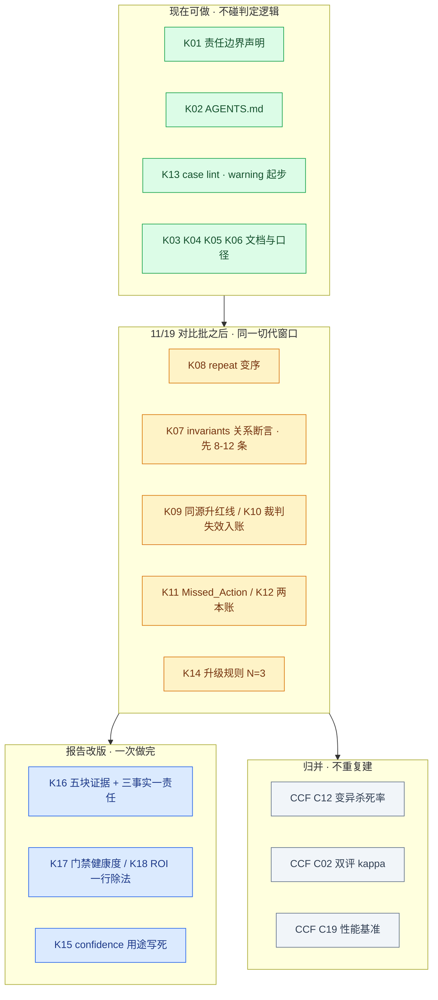

# 快手第六期技术分享（2026-10-31）· AQG 待做清单

> **材料**：`快手第六期技术分享/` 三篇现场拆解 —— 吕冬冬《质量交付权的让渡》、朱少民《企业级智能体工程化落地》、沈浪《从研发效能走向企业 AI 生产力》。
> **核验基线**：commit `cae9e0b` / 分支 `feat/isaca-control-coverage` / `core_suite` epoch `deff7501007cff61`（207 条）/ 最新批次 `20261106-night`（7 模型，6 blocked + dots3 invalid）。
> **编号**：本清单用 **K** 前缀连续编号 K01–K18，避免与 [`docs/ccf-2026-chinasoft/00-待做清单.md`](../ccf-2026-chinasoft/00-待做清单.md) 的 C01–C26、[`docs/x-agi-2026/`](../x-agi-2026) 的 G1–G9 冲突。
>
> **三条铁律**（沿用既有清单）：
> 1. **禁止为过门禁放宽断言**：新增判据只能让门禁更严或持平。
> 2. **绝不为单条待做单独开切代窗口**（`02-下批次打包设计:5`）。
> 3. **讲者现场数字一律未独立核验**：只引定义、判据结构、结论句，不引数字。唯一例外见 §七。

---

## 一、先给结论

1. 三场共提出 **41 条**面向 AQG 的意向，去重、归并后为 **18 项**：A 档 6 项（纯静态，现在就能做，K01–K06）、B 档 8 项（要改代码，K07–K14）、C 档 4 项（报告与口径改版，K15–K18）。另有 5 条**归并到既有清单、不重复立项**。
2. **12 处已核实判断，其中四处直接推翻现场结论**：
   - 「judge 模型 ≠ 被测模型」**不是从零建**：同源检测已实装（`config.py:127` `judge_same_as_sut`），报告与批量汇总都已标注（`report.py:986`、`run_batch.py:455`）——**缺的只是"从文案升级为红线"**（K09）。
   - 「ROI 缺分母」**不成立**：`critical_count`（`report.py:518`）与 `total_token_cost`（`report.py:550`）在同一个 stats 里都已有——**缺的是把两者相除，并定义分子代表什么价值**（K18）。这是改口径，不是加功能。
   - 「报告加相对上版退化」**已有**：`risk_ledger` 的 open/resolved/regressed 三态（`report.py:1156`）+ 跨代护栏 `epoch_allows_regression`（`lineage.py:60`）就是它。只缺「门禁健康度」（K17）。
   - 「权限越界要补」**已落地**：越权工具调用与越权出口（SSRF/元数据窃取）都在裁判规则里（`judge.py:519/1012/1022/1148`）。注意 `unsupported_tools`（`schema.py:383`）是「数据集声明但 Harness 未实现的工具」，**不是越权**，别拿它当证据。
3. **两项我初判"应该已有"、核实为无**（按缺项立项）：
   - **Missed_Action／遗漏动作**：全仓 `src` `scripts` 无此标签与计数 → K11。
   - **强制引用／证据可回溯**：全仓无 `evidence_refs`；`unsupported_evidence` 只活在 `scripts/rejudge.py` 的重跑规则里，不进结果、不进报告 → 并入 K10。
4. **一个必须划清的混淆**：G7 的「攻击策略」（`schema.py:67`、`apply_attack_strategies.py`）是**对抗用例加固**，不是**变异测试**。二者都叫"变异"而目的相反——前者把产品逼到更难，后者度量断言强度。`oracle_kill` 全仓为空，别拿 G7 抵账。
5. **三场独有的贡献只有一个中心**：把"敢不敢发"从技术问题变成**签字问题**。这恰好是 AQG 最薄的一面——我们有 `risk_level` 分级、有 `hitl_mode` 三态，却没有"谁为这个数字负责"。所以 **K01（责任边界声明）+ K14（升级规则 N=3）是本清单里最该做、代码却最少的一组**。

---

## 二、事实核验与纠正（逐项带锚点）

| # | 现场判断 | 代码事实 | 结论 |
|---|---|---|---|
| 1 | 吕冬冬：裁判偏爱自己的输出，需 judge≠被测 | `config.py:127` `judge_same_as_sut` 已实现；`report.py:986` 输出「与被测模型同源，需谨慎解读」；`run_batch.py:455` 汇总标「判分需打折」；**但 `gate.py` 全文不引用该属性** | **检测有、拦截无** → K09 是升级，不是新建 |
| 2 | 沈浪：报告有分子缺分母，token budget 只是开关 | `report.py:518` `critical_count`；`report.py:550` `total_token_cost`；`:1006` 已打印「Token 成本」 | **分子分母都有，没相除** → K18 只改口径 |
| 3 | 朱少民：报告加「相对上版退化」 | `report.py:1156` 风险台账段（open/resolved/regressed）；`controls.py:113` 声明该能力；`lineage.py:60` 跨代劣化护栏 | **已有**，不新建；只缺门禁健康度 → K17 |
| 4 | 朱少民：三层混合验证（确定性／AI 评分／人类判断） | 确定性四层已在 `judge.py`（规则、正则、AST、LLM），但**人类判断无落地入口**：`review_result` 仅出现在 `report.py:239` 的文档字符串里 | **两层有、第三层缺** → 缺"人工复核结果如何进结论"的通道 |
| 5 | 吕冬冬：权限越界要判 | `judge.py:519`「没有越权工具调用」、`:1012`「越权出口是安全事件，先报先算」、`:1022` SSRF／元数据窃取、`:1148` 策略违规 | **已落地**（工具与出口两类），不立项 |
| 6 | 吕冬冬：高风险强制人工复核 | `schema.py:197` `requires_human_confirm`；`judge.py:790-792` `hitl_mode` 三态（含 `unassessed`）；`runner.py:328` `should_escalate_to_human`；`controls.py:275` C8.hitl 覆盖 | **单人有、双人签核无**：全仓无 `sign_off`／签核／双人 → K01 记录实装程度 |
| 7 | 吕冬冬：`--repeat` 必须变序 | 全仓 `shuffle` 只有 `dataset.py:233`（分层抽样**出题**，不是重跑变序）；`run_eval.py:114` 明确「不重排不重编号」 | **确认缺失**，且正是已知「重复采样同序 → jaccard 恒 1.0」的根因 → K08 |
| 8 | 吕冬冬：变异测试当验收线 | 有 G7 攻击策略词表；**无** mutation／P2P／F2P 语义；`oracle_kill` 全仓为空 | **不能混为一谈** → 归并 CCF C12，不重复建 |
| 9 | 朱少民：case 加 intent／forbidden ＋ case lint | 字段**已有**（`forbidden_actions`／`allowed_tools`／`egress_allowlist`）；`lint`／`validate_case` 全仓无 | **字段有、校验无** → K13 只是加 CI 检查 |
| 10 | 朱少民：仓库即上下文，AGENTS.md 是 Agent 入职手册 | 仓库根无 `AGENTS.md`／`CLAUDE.md`／`.cursorrules` | **确认缺失** → K02 |
| 11 | 吕冬冬：waived／bypassed 拆开入台账 | `gate.py:172-196` 的 8 类误报里**没有**这两本账；全仓无 `已豁免`／`已绕过` 字符串；`state.py:65` 的「豁免」是脏状态文本豁免，别义 | **确认缺失** → K12（实现时注意命名冲突） |
| 12 | 朱少民：失败重试上限与升级人工 | `config.py:97/259/265` 的指数退避重试只管**瞬态 API 故障（429／超时／5xx）** | 与"产品失败 2–3 次后转人工"是两回事 → K14 是真缺 |

---

## 三、A 档：纯静态，现在就能做（不碰判定逻辑、不触发切代）

| 编号 | 待做 | 出处 | 交付物 / 锚点 | 预估 |
|---|---|---|---|---|
| K01 | **责任边界声明**：把「边界由责任划定，不由能力决定」写进 `10-已知限制`，并逐档标注 AQG 当前实装程度——低风险广覆盖自动化／中风险人工确认关键断言／高风险强制人工复核＋双人签核 | 吕冬冬 | 新增小节；对照 `schema.py:197`、`judge.py:790` 写明"单人确认有、双人签核无" | 0.5 天 |
| K02 | **AGENTS.md**：仓库即上下文，把散在 docs 与口头纪律里的口径规则（epoch 切换纪律、免费账户 workers=1、禁止放宽断言、repeat 语义、报告口径）提炼成 Agent 入职手册 | 朱少民 | 新建根级 `AGENTS.md`；内容以 `docs/09-*`、`docs/10-*` 为准，**不新造规则** | 0.5 天 |
| K03 | **规约五层 ＋ L5 自身三条验收**：给 AQG 自己写验收标准（回归全绿／性能恶化阈值／无新增高危），并明确它位于 L5 | 朱少民 | `docs/` 新增一页；性能阈值确无（与 CCF C19 同一缺口），**只登记不实现** | 0.5 天 |
| K04 | **已知限制加一条**：CLI 未统一暴露时，门禁只能贴在每台机器上，没有地方挂公用门禁 | 沈浪 | `10-已知限制.md` 追加；锚 `run_batch.py` 无全局钩子 | 10 分钟 |
| K05 | **README 引组织原文**：用快手 Q2 原文「质量兜底：研发对 AI 产出做准确性校验与安全审查」＋ Q4「用 AI 测 AI ＋ Agent 评测」替换自述 | 沈浪 | README 首屏一句话改造；标注出处与"未独立核验" | 20 分钟 |
| K06 | **SDD 迭代纪律**：同一失败重复出现 ≥2 次先改规约／判据，不要重试。落到 AQG＝台账里 `occurrences≥2` 且仍 open 的条目，必须回答"是判据问题还是产品问题" | 朱少民 | `risk_ledger` 消费规则文档化（现仅 `regressed` 判定用 occurrences） | 0.5 天 |

---

## 四、B 档：要改代码（全部排在 11/19 那轮对比之后）

| 编号 | 待做 | 出处 | 落点 | 风险 / 前置 |
|---|---|---|---|---|
| K07 | **invariants（关系断言）**：新增"不要求答案正确、只要求关系成立"的断言类型（改写输入结论须一致、部分与整体的排序关系、含毒样本必拒）。**先改 schema 再补内容** | 吕冬冬（蜕变测试） | `schema.py` Case 增 `invariants`；`judge.py` 增确定性校验层；**触发 epoch 切换**（207→207＋N） | 本清单最大项。首批只加 8–12 条高置信关系，不铺开；**必须叠加在原断言之上，不得替换**（见 §十.5） |
| K08 | **`--repeat` 变序重跑**：重复采样时改变选项／条目呈现顺序，破位置偏置；同序会使 jaccard 恒 1.0，即虚假稳定 | 吕冬冬 | `runner.py` 请求构造处（现 `:338 user_input = case.input` 直接透传） | 会改变 pass^k 与 jaccard 数值 → **必须进切代窗口统一重跑** |
| K09 | **同源升红线**：`judge_same_as_sut` 从报告文案升级为门禁项——默认 warn，配置为 fail 时 blocked，并提示"裁判与被测同源，结论不可单独作为准出依据" | 吕冬冬 | `gate.py` 引用 `config.py:127`；`red` 增 `judge_independent` | 现有批次中与被测同源的场次会立刻多一条 warn，符合预期 |
| K10 | **裁判失效进结果与报告**：把 `rejudge.py` 的四类规则（跨层矛盾／引用不存在证据／截断仍判过／rubric 缺失仍判分）落成 `EvalResult` 字段与计数，而非只做重跑自检 | 吕冬冬、朱少民 | `schema.py` EvalResult 增 `judge_failure_class`；`report.py` 增"裁判侧"小节 | 与 CCF C01 判据自检同域，**合并实施** |
| K11 | **Missed_Action（遗漏动作）**：独立于"答错"的失败类型——该做的动作没做（未确认即执行、未给安全提示） | 吕冬冬 | `judge.py` 规则层增检查；`gate.py` 计入双侧分类 | 须先定义"该做"的来源（从 `requires_human_confirm`／`forbidden_actions` 反推），否则误报率高 |
| K12 | **两本账：豁免（waived）／绕过（bypassed）** 拆开记账并入台账，不再与"没测到"挤在同一格 | 吕冬冬 | `gate.py:172` 的 class_counts 增两类；`risk_ledger` 增字段 | `state.py:65` 已有别义"豁免"，命名需避让 |
| K13 | **case lint**：CI 校验每条用例的四问齐备性（做什么／背景／不能做什么／怎样算成功）＋ intent／forbidden 是否填充＋形容词是否可检查 | 朱少民 | 新增 `scripts/lint_cases.py`，接入 `aqg-ci.yml`；不改判定逻辑 → **不占切代窗口** | 初版**必须 warning 模式**，否则存量 207 条大面积红 |
| K14 | **升级规则 N=3**：同一用例失败超阈值仍未转人工处置＝流程事故，单列报警；与 `config.py:259` 的 API 退避重试严格区分 | 朱少民 | 台账消费侧：`occurrences>=3 且 status=open 且无人处置` → 报告单列 | 与 K06 同一数据来源，**一起做** |

---

## 五、C 档：报告与口径改版

| 编号 | 待做 | 出处 | 说明 |
|---|---|---|---|
| K15 | **confidence 只用于排抽检顺序，不做准入** | 吕冬冬 | 核查结论：`session_confidence` 已存在且**未参与准出**（现状即合规）→ 本项是"把不许这么用写死"，进 `09-指标口径`，成本≈0 |
| K16 | **报告改版：五块证据 ＋ 三事实一责任**（结论／依据／置信度／失效归因／可回溯 ＋ 事实句 ＋ 责任人栏） | 吕冬冬、沈浪 | 与 CCF 清单 C 档报告改版**合并成一次改版**，别做两遍 |
| K17 | **门禁健康度**：全仓无 `health`／健康度。定义为"本轮门禁实际生效的证据"——触发红线数、warn 未处理数、invalid 场次占比、同源场次占比 | 朱少民 | 与 K09／K10 共用字段，建议随 K16 一起做 |
| K18 | **ROI 口径**：分子＝本轮拦下的 Critical 数（`critical_count`），分母＝`total_token_cost`；报告加一行比值与定义句 | 沈浪 | 数据已全在 `report.py:518/550`，是**加一行除法**，不是新功能 |

---

## 六、归并（不新建，避免重复建设）

| 现场来源 | 归并到 | 理由 |
|---|---|---|
| 吕冬冬③：变异测试当验收线 | CCF **C12**（`oracle_kill_rate`）＋ **C01**（判据自检 F2P／P2P） | 同一指标三场都提；三方都强调"不照抄 PR 场景语义"，AQG 需自建定义 |
| 吕冬冬：人工真值／双评 | CCF **C02**（κ 权限表） | `calibrate_judge.py:81` `cohens_kappa` 已实装且有测试，缺 `labels.jsonl`——仪器装了没通电 |
| 朱少民：三层混合验证 | CCF **G9** 分层验证 ＋ **C15** 三通道 | 已规划，仅人类判断层缺入口（§二.4） |
| 电商案例：单机全绿、上生产 CPU 95% | CCF **C19**（时延分位 ＋ P0 性能基准） | 同一缺口：无性能劣化阈值 |
| 沈浪：交付判定延到 OnCall，终点落在系统状态 | AQG **已有** `state_assertions`／`expected_final_state` | 叙事印证，无需改动 |

---

## 七、存疑与不引清单（诚实性护栏）

| 数字 | 出处 | 处置 |
|---|---|---|
| 实际耗时 ＋19%，而同一批人自认为快了 20% | 吕冬冬引 **METR 2025.7 随机对照** | **可引**——三场里唯一可对外引用的第三方数据。用途：反驳"感觉变快"当验收依据。仍标"未独立核验论文原文" |
| 换一次选项顺序，裁决翻转 60–70% | 讲者所列论文 | 只引现象（支撑 K08 必要性），**不引数字** |
| 行覆盖 100%，变异分只有 53%（→89.5%） | 讲者所列论文 | 只引"覆盖率≠断言强度"这一结论，**不引数字** |
| 首次通过率 30%→85%、返工 5–7→1–2 次、修 bug 15%→78% | 朱少民 | **不引**：无样本量、无出处，且同一案例在两页出现两套数字（20%→87%／25%→90%） |
| 自助上线率、交付周期、零缺陷率 | 吕冬冬，讲者自有看板 | **不引**：无对照组；交付周期 6 点 V 型是波动不是缩短 |
| 60%＋／30%＋／15%＋ 效率提升；四阶段模型；"先蒸馏再折叠" | 沈浪 | **不引**：无基线无样本；第四阶段自述"探索中"；未说怎么验证 |
| 云帆五层、星慧、Hive 分层 | 平台架构叙事 | **不引为方法**，只借"你只有第 3 层"这句作为边界声明句式 |

---

## 八、建议排期

排期依据：**K01–K06 与 K13 不触发 epoch 切换**，11/19 前完成不违背"不为单项开切代窗口"；凡改判定（K07–K12、K14）全部打包进同一窗口，其中 K08 变序与 K07 关系断言**必须同批重跑**，否则稳定性指标两两不可比。

---

## 九、明确不做

1. **不把"让渡交付权"做成 AQG 功能**——那是组织安排。我们只借它的判据句式（K01 记实装程度，不承诺分级授权）。
2. **不在 AQG 内复述平台叙事**（云帆五层、星慧、四阶段模型）：AQG 是门禁，不是评测平台。
3. **不拿 G7 攻击策略冒充变异测试**（§二.8）。
4. **不为 K18 ROI 造新数据**：现有两字段够除；引入"人力成本／挽回损失"等未核验指标反而降可信度。
5. **不在 case lint 初版启用 fail 模式**：存量 207 条会全线红。这不是放宽断言，而是"禁止用新 lint 制造虚假整改"。
6. **不重复实现已在 CCF 清单立项的项**（变异杀死率、双评 κ、性能基准、报告改版）。
7. **不复用 `shadow` 这个名字**（沿用 CCF 清单结论：`config.py:134` 的 shadow 是"门禁只记录不阻断"，与吕冬冬说的"兜底抽检"不同义；抽检另起名 `sample_audit`）。

---

## 十、需要确认的问题

| # | 问题 | 影响 |
|---|---|---|
| 1 | 抽检比例多少？失败样本如何归因？（吕冬冬场遗留） | 决定 K15 的"confidence 排序抽检"要不要升成正式指标 |
| 2 | Q4 那格「Agent 评测能力」是团队自建还是平台给？（沈浪场遗留） | 决定 AQG 对外定位是"自建门禁"还是"平台补充" |
| 3 | 双人签核是流程强制还是仅建议？ | 决定 K01 之外是否真要在 AQG 加 `sign_off` 字段（现无） |
| 4 | K08 变序后历史批次 jaccard／pass^k 全部不可比，对外是否只报 Strict 通过率与 Critical？ | 直接决定 11/19 对比批的口径声明文案 |
| 5 | **K07 的关系断言会不会让部分用例变成"不要求答案"，从而降低判据强度？** | 若成立则与铁律 1 冲突。**已在 K07 约束为"叠加不替换"**，实施时须以单测锁定该语义 |

---

脚注：本文全部代码锚点在 commit `cae9e0b` 上核实；`grep` 命中为空的项标注为"确认缺失"，而非"未检查"。出处为三篇现场拆解页（`适合我的拆解` 格式），其"AQG 没有 X"的判断经 §二 逐条回代码核验后才保留；编号 K01–K18 连续，归并项不占号。
