# AQG 待做优先级（2026 Q4）· 跨四份来源的统一排序

> **用途**：把散在四份清单里的未完成意向收成**一张可执行顺序表**，避免各文档各自排序、互不知情。
> **核验基线**：commit `4e8fff4` / 分支 `feat/isaca-control-coverage` / `core_suite` epoch `deff7501007cff61`（207 条）/ 最新批次 `20261106-night`。
> **来源**：[`../ccf-2026-chinasoft/00-待做清单.md`](../ccf-2026-chinasoft/00-待做清单.md)（C01–C26）· [`../kuaishou-tech-talk-06/00-待做清单.md`](../kuaishou-tech-talk-06/00-待做清单.md)（K01–K20）· [`../x-agi-2026/01-可落地缺口清单.md`](../x-agi-2026/01-可落地缺口清单.md)（G1–G9）· [`../isaca-securing-ai-agents/00-差距与优化路线.md`](../isaca-securing-ai-agents/00-差距与优化路线.md)（C1–C11＋附录 A）。
> **本文不含代码改动**，只做排序与裁剪；实现须另立评审并配套单测。

---

## 一、档位判据（先定义，再排序）

| 档 | 判据 | 时间含义 |
|---|---|---|
| **P0** | 不做，则 11/19 对比批的**分数不可被引用**或口径自相矛盾 | 11/19 前，且**不触发 epoch 切换** |
| **P1** | 只补文档／声明，不影响"分数可信度"，但成本低、宜同窗完成 | 11/19 前随手做 |
| **P2** | **改判定**（新增或收紧判据），必须打包进同一切代窗口 | 11/19 对比批之后 |
| **P3** | 报告改版、主打实验、能力扩面 | 窗口之后 |
| **P4** | 暂不做：诉求未明、架构级、或依赖未到位 | 有明确触发条件再立项 |

两条硬约束贯穿全表：**① 禁止为过门禁放宽断言**（新增判据只能更严或持平）；**② 绝不为单项单独开切代窗口**（`02-下批次打包设计:5`）。

---

## 二、清账：58 条原始意向 → 49 项

> **编号约定**（两家撞名，必须带前缀）：**`C` 裸数字＝CCF 清单**（C01–C26）；**`ISACA-C` ＝ ISACA 控点**（C1–C11）。两者无对应关系（CCF C03 是 `spec_leak`，ISACA-C3 是身份授权）。

| 来源 | 未完成原始条数 | 说明 |
|---|---|---|
| CCF ChinaSoft | 26（C01–C26） | 源文档已声明 C10→G2、C18→G7 两条归并 |
| 快手第六期 | 20（K01–K20） | 11-09 二次核验后从 18 增至 20（新立 K19／K20） |
| ISACA 差距路线 | 7 | ISACA-C1 治理、ISACA-C3 多租户、ISACA-C6.3 投毒、ISACA-C6.4 落盘、ISACA-C9 审计链、ISACA-C11／C8 降级、附录 A |
| X-AGI 2026 | 5 | G2、G4、G5、G8、G9（G1／G3／G6／G7 已实现） |
| **合计** | **58** | 再合并 3 组跨源撞车（净减 9 条）→ **49 项** |

### 真正合并的三组

| 合并组 | 覆盖 | 净减 |
|---|---|---|
| **M1 责任入账** | ISACA-C1（台账 `owner`／`risk_accepted_by`）＋ K01（责任边界档位声明）＋ C24（边界声明重写）＝3 条→1 项。*K14 消费此字段，但独立立项，不并入本组* | 3→1（净减 2） |
| **M2 报告一次改版** | C20（三层证据版式）＋ C21（箱线图与方差图）＋ C22（不出总排名改适用条件）＋ C23（`pass_rate_bias`）＋ K16（五块证据三事实一责任）＋ K17（门禁健康度）＋ K18（ROI 一行除法）＝7 条→1 项 | 7→1（净减 6） |
| **M3 难度分层** | CCF C10 → x-agi **G2**（源文档已声明，不重复立项） | 1→0（净减 1） |

### 只是同族、**不合并**的四组（合并会丢东西）

| 族 | 成员 | 为什么不能合成一项 |
|---|---|---|
| 判据强度 | C01 自检、C18 断言强度、K07 关系断言、K13 case lint | 分别回答"题能不能区分对错／断言够不够狠／关系成不成立／用例写没写全"，四种失效模式互不覆盖 |
| 异源 | K09 裁判同源升红线、C08 harness 指纹 | K09 只改门禁引用（半天），C08 要建指纹体系；放一起会让 K09 被 C08 拖住 |
| κ／双评 | C02 权限表、C16 异模型二裁 | C16 该等 C02 出结论再决定，不是同期建设项 |
| 题库代谢 | C11 谱系四字段、C13 行为索引、C19 退役态、C26 真 issue 造题 | 四个字段各管一事，合成"题库优化"就没人能开工 |

---

## 三、P0｜11/19 前必须（9 项，约 6.5 人日）

这一档的共同点：**不做就没法对外说这批分数可信**。

> **完成度不在本表维护**（本表只保留原始排序与成本，避免两份文档各记一套）：实时状态看 [`01-每日排期.md`](01-每日排期.md) §二「进度总览」。

| # | 项 | 为什么卡在这里 | 成本 | 锚点 |
|---|---|---|---|---|
| 1 | **C01 判据自检**（AQG 版 F2P／P2P，离线喂裁判） | 蒋思源那句"先确认任务可信，再扩大数据规模"是排期依据不是口号：对比轮一旦先出跑分，"题本身可不可信"就永远问不出口 | 1–2 天 | `positive_reference`／`negative_reference` 已有，缺自检回路 |
| 2 | **C02 κ 权限表进 gate**（先造 `labels.jsonl` 40 条分层标注） | `calibrate_judge.py:81` `cohens_kappa` 已实装且有测试，但 `gate.py` 不引用 → 现在"哪些指标有权 blocked"是**借来的阈值** | 1 天 | 仪器装了没通电 |
| 3 | **C03 `spec_leak`** 可判信息泄漏检查 | 判据是否泄漏给被测，决定"这分数是闭卷还是开卷"。当前 API 型被测天然满足（`runner.py:338` 只发 `case.input`），但**这个前提从未被机器验证过** | 0.5 天 | 与 K07/G8 上线后才会破 |
| 4 | **C04 可判率＋重复率体检**（绑 target） | 与 C01 同属"题的地基"；`build_suite.py:33 dedupe_file()` 已有地基 | 0.5 天 | 必须绑定 target，否则跨模型不可比 |
| 5 | **C14′ `fixture_ready` 前置校验**（裁剪版，裁剪理由见 §九.5） | 现状比“没校验”更糟：`Sandbox` 写 fixture 失败被包成 `error_message`，却**不带** `precondition_failed`（等于指望一个从不发生的归因），gate 于是把环境故障算进分母、记成模型答错——模型一句话都没说。预检要同时把归因改对 | 0.5 天 | `runner.py` 构造 `Sandbox` 的分支无预检 |
| 6 | **K13 case lint**（warning 起步） | 207 条用例的四问齐备性从未被机器查过；这是唯一能**持续防退化**的机制 | 1 天 | 新增 `scripts/lint_cases.py` ＋ 接 CI |
| 7 | **K08 变序——只拍决策，实现在 P2**（✅ 11-11 已拍 A：实现提前至批前，见 [`01-每日排期.md`](01-每日排期.md) §一） | 见 §八，这是全部 49 项里唯一**时机比工作量重要**的一项 | 决策 0 | `run_eval.py:114`「不重排不重编号」 |
| 8 | **M1 责任入账**（ISACA-C1 ＋ K01 ＋ C24 合并） | 三源指向同一处空白：我们有 `risk_level` 和 6 值 `hitl_mode`，却没有"谁为这个数字签名"。这也是 K14 的落点 | 1 天 | 台账补 `owner`／`risk_accepted_by` |
| 9 | **ISACA 附录 A 分级口径冲突** | 唯一"被问倒就难看"的自相矛盾：ISACA 把政府证件号归 RESTRICTED，本项目 `id_card` 命中后走 S2 **脱敏上云**。要么改映射，要么写清"令牌化 vs 脱敏" | 0.5 天 | README 需写映射表 |

> P0 全部满足"不触发 epoch 切换"。做完 P0，11/19 批的结论才立得住。

---

## 四、P1｜11/19 前随手做（6 项，约 2 人日）—— ✅ 11-14 全部清账

只补文档与声明，不影响分数可信度，但成本低、宜同窗带走。**六项无代码改动 → 代际 `deff7501007cff61` 不变**。

| 项 | 内容 | 成本 | 落地 |
|---|---|---|---|
| K02 | `AGENTS.md`：仓库即上下文，把已有口径纪律提炼成 Agent 入职手册（现根目录无此文件） | 0.5 天 | ✅ 根级 `AGENTS.md`：路由表＋七条纪律（每条带出处，不自造规则）＋术语速查 |
| K03 | 规约五层＋L5 自身三条验收（回归全绿／性能恶化阈值／无新增高危）——**只登记，实现是 K19** | 0.5 天 | ✅ `docs/quality/01-自验收与规约五层.md`；第 2 条认领为**真缺口**（K19），第 3 条认领为半缺口（K14/K17）；层名不转述（仓库未落档） |
| K04 | 已知限制加一条：CLI 未统一暴露时门禁只能贴每台机器 | 10 分钟 | ✅ README 中英「已知限制」；钝在 `run_batch.py` 无全局钩子、`.git/hooks` 只有样例、CI 不调模型 |
| K05 | README 引快手 Q2 原文「质量兜底：研发对 AI 产出做准确性校验与安全审查」替换自述 | 20 分钟 | ✅ 首屏引述块（中英），标出处＋未独立核验＋只接立场不引数字 |
| K06 | SDD 纪律：台账 `occurrences≥2` 仍 open 的条目须回答“判据问题还是产品问题” | 0.5 天 | ✅ `docs/quality/02-台账消费与SDD迭代纪律.md`：T1/T2/T3 三层（5 / 140 / 129 条），回答三选一 |
| K15 | 写死 `confidence` 只做抽检排序、不做准入（现状即合规，补文档防倒退） | 0.5 天 | ✅ 写进 README「排名与显著性」；**前提纠错**：本仓库无 `confidence` 字段（见 §九.9） |

---

## 五、P2｜随 11/19 切代窗口（14 项）

全部是**改判定**，按纪律打包进同一窗口，不单项开窗。

| 项 | 内容 | 是否触发 epoch |
|---|---|---|
| **K07** | invariants 关系断言（蜕变测试）；**必须叠加不替换** | ✅ 是（207→207＋N） |
| **K08** | `--repeat` 变序实现 | ❌ 否，但打断历史可比性 |
| K09 | 同源升红线（`gate.py` 引用 `config.py:127`） | ❌ |
| K10 | 裁判失效四类进 `EvalResult` 与报告（＋ C05 `exception_scope_check` 同域） | ❌ |
| K11 | Missed_Action 遗漏动作 | ❌ |
| K12 | 两本账 waived／bypassed —— **成本已下调**：`bypassed` 已在 `hitl_mode`（`judge.py:1276`），只缺 `waived` 一维与分账 | ❌ |
| K14 | 升级规则 N=3（消费 M1 的 owner 字段） | ❌ |
| **K19** | 性能与成本红线（延迟分位＋token 经济性）——**新增缺口**，缘由见 §九.3 | ❌ |
| **K20** | 人工复核结果进结论的通道——**新增缺口**，缘由见 §九.1／§九.4 | ❌ |
| C06 | 静态配置审计器（**C20／M2 的前置**，必须先于报告改版） | ❌ |
| C09 | `recovery_rate`：`error→retry→success` 计数（B 档最便宜，`retry_count` 字段已有） | ❌ |
| C11 | case schema 四段 `difficulty_source`／`locator`／`hint_level`／`spec_leak` | ✅ 是 |
| C18 | `oracle_strength`（归 G7 新用途，不新建机制） | ✅ 是 |
| G2 | 难度分层 IRT-lite（含 M3 的 CCF C10）——需再攒一个窗口才能验证 | ✅ 是 |

> **K07 与 K08 必须同批重跑**：一个改数据集、一个改执行方式，分开做会让稳定性指标两两不可比。

---

## 六、P3｜窗口之后（16 项）

| 簇 | 项 | 备注 |
|---|---|---|
| **报告一次改版** | M2（C20＋C21＋C22＋C23＋K16＋K17＋K18） | 依赖 C06 先落地，否则 State 那层是空壳 |
| **主打实验** | C08 harness 指纹 → C25 `--swap-harness` 判定翻转率 | 黑盒评测做不了，是 AQG 抢不走的差异点；C25 硬依赖 C08 |
| **证据与谱系** | C12 evidence 钉版本、C17 `derived_from`（先只记录不判定） | 防行号漂移导致引证不实 |
| **题库代谢** | C13 行为索引、C19 `case_status` 退役、C26 抓 AtomGit／Gitee 真 issue 造题 | 别追覆盖面，向"新增特性／修复缺陷"两类集中 |
| **架构改动** | C15 rubric 三件套 `state`／`error_tag`／`deduct_rule` ＋ `verdict=min()` | 与"禁止 LLM 主观判分"同向，但是 judge 输出协议级改动 |
| **审计扩面** | C07 约束文件自身进被审计对象 | 硬依赖 C06（P2）先定义"哪些文件算约束"，不能反超 |
| **ISACA 尾巴** | ISACA-C3 多租户作用域族、ISACA-C9 journal 哈希链＋`incident_packet`、ISACA-C6.3 记忆投毒探针、ISACA-C6.4 落盘策略、ISACA-C11／C8 降级模式（`agent_mode`） | 附录 A 的 Keep／Dispose 维度随 ISACA-C6.4 一起做 |
| **低成本可插队** | G5 动态评测权重 | 便宜，但警惕被当成"放宽断言的配置自由度" |

---

## 七、P4｜现在不做（4 项）

| 项 | 为什么不排 | 触发条件 |
|---|---|---|
| G4 真 MockUser 多轮施压 | 中等工程，要改 runner 执行模型 | 出现明确长程评测诉求 |
| G8 多 Agent 链路被测 | 架构级，不混进常规批次 | 单独立项评审 |
| G9 设计质量维度 benchmark | 仍是设计稿，缺实施条件（无 UI／设计工件输入） | 有可判对象后再开 |
| C16 异模型二裁＋仲裁 | 应等 C02 的 κ 出结论，否则不知"不一致该转给谁" | κ 权限表落地后重评 |

---

## 八、如果只拍一件事：**K08 变序的时机**

P0 其余 8 项都是**加东西**，只有 K08 是**主动打断可比性**：

| 何时改 | 损失 |
|---|---|
| **11/19 基线批之前** | 损失一次重跑（那批本来就是第一个基线） |
| 11/19 之后 | 损失两个基线（`20261106-night` ＋ 11/19 批）的历史 jaccard／pass^k 可比性 |

变序不改 `core_suite` 指纹，因此**不触发切代**，但它让"重复采样同序 → jaccard 恒 1.0"这个已知虚假稳定失效——也就是说现在的稳定性数字**偏乐观**。这一条决定 11/19 批的口径声明文案，比其余待做都早一步。

> **落地回执（11-14，比排期提前 3 天）**：实现形态与原设想不同，必须先说清楚：快手原话的“改变选项／条目呈现顺序”在 AQG 题面上**没有可安全施力的对象**——实测 207 条题面只有 5 条多行，且全部是注入类上下文（“忽略上面的总结任务”直接指向段落位置），洗那些段落等于改题目语义。真正的根因在**采样侧**：`--seed` 默认 42，而 `--repeat` 的每次尝试都用同一个种子。落地为 `runner.attempt_seed(k)` 逐次派生（第 0 次保持原值）＋ `AgentTrace.seed` ＋ `stability.attempt_divergence` 量化，详见 `CHANGELOG.md` 同条。**口径变化**：`20261106-night` 及更早批次的稳定性偏乐观，11/19 批起才是真实数值，两者不可比（原判定不变，仅实现路径修正）。

---

## 九、本轮 check 的更正记录（不含代码改动）

| # | 更正 | 性质 | 后果 |
|---|---|---|---|
| 1 | 快手初版 §二.4 引用锚点 `report.py:239` 的 `review_result` **不存在**（全仓大小写不敏感零命中；`review` 只在网关内容审核 `judge.py:193` 与 `preview` 变量名里出现） | 我写下的**事实性错误** | 结论不变（人类判断层无入口），依据改为"零命中"，据此新立 **K20** |
| 2 | `hitl_mode` **不是三态，是 6 值**：`bypassed`(:1276)／`escalated`(:1295,:1307)／`refused`(:1315)／`silent`(:1328)／`unassessed`·`not_required`(:792) | 低估现状 | **K12 成本下调**——`bypassed` 裁判侧已能识别，只缺 `waived` 一维与 gate 分账 |
| 3 | 初版把"性能与成本红线"**归并给 CCF C19**，而 C19 实为 `case_status` 退役；CCF 清单里根本没有性能项（`recovery_latency` 属 C17）。`gate.py` 阈值只有 `jcv_threshold=0.6`／`min_valid_rate=90`／`breaker_threshold=5`，无任何延迟或 token 经济性红线 | **为少开项硬找挂靠** | 作废归并，新立 **K19**（真缺口） |
| 4 | 初版把"三层混合验证"归并给"**CCF** G9 分层验证 ＋ C15 三通道"：G9 属 `docs/x-agi-2026/` 不属 CCF；C15 是石琳的 rubric 三件套 `state/error_tag/deduct_rule`，与"确定性／AI／人类"三层不同物 | 同上 | 作废归并，归入 **K20** |
| 5 | CCF **C14 需裁剪**：`compiles` 前置 gate 对 AQG 不适用（被测是 API 型 agent，无编译步骤）；`fixture_ready` 那半成立但形态不同——沙箱 fixture 只由 `runner.py:354` 注入＋schema 类型校验，跑前不确认落盘 | 外部意向落地裁剪 | 保留为 P0 第 5 项 **C14′**，只做 fixture 半 |
| 6 | 初版 §二.11 写「`gate.py:172-196` 的 **8 类误报**」——实际 `failure_class.py:30` 的 `FAILURE_CLASSES` **只有 4 类**（`precondition_failed`／`unknown`／`orphan_effect`／`framework_decision`），`gate.py:172` 注释亦写「四类误报」 | 数字写错 | K12 工作量略降（只需在 4 类上扩 2 类）；不影响分档 |
| 7 | 初版把别义"豁免"锚到 `state.py:65`——**文件指错**：`state.py:65` 是 `created = sorted(...)`，无该字；真处在 `state.py:337`（脏状态文本豁免词表）与 `dataset.py:65`（被豁免的写入步数） | 锚点指错文件 | 仅影响 K12 实现时的命名避让提示，结论不变 |
| 8 | K08 的“变序”被记成“重复采样轮间洗牌”，暗示要洗题面条目。实测 207 条题面只有 5 条多行且全为注入类上下文，**洗题面这半无对象可施**；真因是 `--seed` 默认 42 被所有 repeat 轮次复用 | 实现路径误判 | K08 落地为采样种子逐次派生（不改题面、不切代），成本不变；口径影响见 §八 回执 |
| 9 | K15 的前提「`session_confidence` 已存在且未参与准出」**不成立**：全仓大小写不敏感**零命中**，AQG 从来没有 `confidence` 字段 | 把外部实现的字段当成本仓库现状 | 结论不变（本来就该写死），依据改为「`wilson_interval` 只用于 `report.py` 展示与 `drift_check.py` 漂移比对，`gate.py` 全文不引用」；落地见 README「排名与显著性」 |
| 10 | 待办写「现仅 `regressed` 判定用 occurrences」——`regressed` 实由同代内 `previous_status==resolved` ＋ `epoch_allows_regression` 判定（`report.py:824-830`），`occurrences` **零判据消费**，只是计数与展示 | 归因链记错 | K06 缺口更重：不是“只有一处用它”，而是“完全没人用”；阈值因此改为按实测定（T1 5 条 / T2 140 条 / T3 129 条），成本不变 |

---

## 十、执行节奏

```mermaid
flowchart LR
    subgraph P0["P0 · 11/19 前 · 保分数可信 · 9 项"]
        P1a["C01 判据自检"]
        P1b["C02 kappa 权限表"]
        P1c["C03 spec_leak / C04 可判率"]
        P1d["C14 前置校验 / K13 case lint"]
        P1e["M1 责任入账 / 附录A 口径"]
        P1f["K08 变序决策"]
    end
    subgraph BASE["11/19 对比基线批"]
        B["7 模型 x 207 条 · 口径声明"]
    end
    subgraph P1T["P1 · 随手做 · 6 项"]
        Q["K02 K03 K04 K05 K06 K15 · 纯文档"]
    end
    subgraph P2T["P2 · 切代窗口 · 14 项"]
        R["K07 关系断言 + K08 变序 同批重跑"]
        R2["K09 K10 K11 K12 K14 K19 K20"]
        R3["C05 C06 C09 C11 C18 G2"]
    end
    subgraph P3T["P3 · 之后 · 16 项"]
        S["M2 报告一次改版"]
        S2["C08 指纹 → C25 换脚手架实验"]
        S3["题库代谢 / 谱系 / ISACA 尾巴"]
    end
    P4["P4 · 不做 4 项：G4 G8 G9 C16"]
    P0 --> BASE
    P1T --> BASE
    BASE --> P2T --> P3T
    P4 -.->|有触发条件再立项| P3T
    classDef p0 fill:#FEE2E2,stroke:#DC2626,color:#7F1D1D;
    classDef bs fill:#FEF3C7,stroke:#D97706,color:#78350F;
    classDef p1 fill:#DCFCE7,stroke:#16A34A,color:#14532D;
    classDef p2 fill:#DBEAFE,stroke:#2563EB,color:#1E3A8A;
    classDef p3 fill:#F1F5F9,stroke:#64748B,color:#334155;
    classDef p4 fill:#F5F5F4,stroke:#A8A29E,color:#57534E,stroke-dasharray: 4 3;
    class P1a,P1b,P1c,P1d,P1e,P1f p0;
    class B bs;
    class Q p1;
    class R,R2,R3 p2;
    class S,S2,S3 p3;
    class P4 p4;
```

今天 11-09 到 11-19 有 10 个日历天。P0 约 6.5 人日、P1 约 2 人日，**同窗并行不冲突**（P1 全是文档，P0 只有一项要写代码），排得下。真正的瓶颈不是工时，是 §八 那个决策——它拖过 11/19 就涨价。

> **决策回执（11-11）**：§八 已拍 **A——变序在 11/19 批前实现**（0.5 天，排 11-17 晚；若未完自动退回 P2）。P2 表中的 K08 实现条目相应前移，P2 仅保留与 K07 同批重跑的衔接纪律。逐日落地见 [`01-每日排期.md`](01-每日排期.md)。

---

脚注：本文所有代码锚点在 commit `4e8fff4` 上核实；§九 是本轮 check 的完整更正记录，其中 **#1／#3／#4／#6／#7 属于我自己前一份文档的错误**（两处硬找归并对象、三处锚点或数字写错），已同步改入 [`../kuaishou-tech-talk-06/00-待做清单.md`](../kuaishou-tech-talk-06/00-待做清单.md)。计数口径：58 条原始意向，M1 净减 2、M2 净减 6、M3 净减 1（共 9），得 49 项；分档 9＋6＋14＋16＋4＝49（已计入补上的 C07）。
