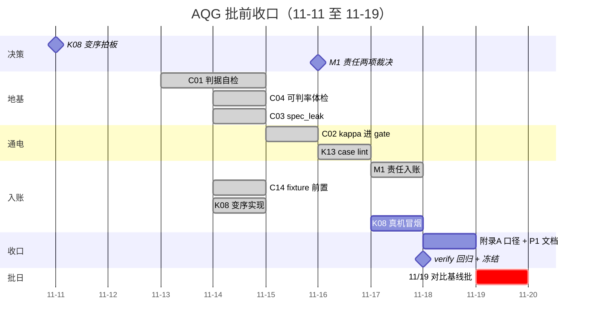

# AQG 批前每日排期（11-11 → 11-19）

> **依据**：[`00-待做优先级.md`](00-待做优先级.md) 的 P0×9 与 P1×6，全部须在 11/19 对比基线批开跑前收口。
> **硬约束**：11-12 整天不排（预留日）；禁止为过门禁放宽断言；不为单项单独开切代窗口。
> **基线**：commit `cca9da3`（初排于 `3caa778`；P0×9＋P1×6 落地于 `ff0677e`）/ `core_suite` epoch `deff7501007cff61`（207 条）/ 最新批次 `20261106-night`。
> **用法**：每天收工前核对当日"出口标准"，做到就打勾；任何一天掉队，按 §五 裁剪顺序执行，不临场纠结。
> **进度看哪里**：§二 开头的「进度总览」是唯一完成度口径（P0 净完成数／剩余人日／待你裁决的前置）；逐日勾选只是过程记录，两者不一致时以总览为准。

---

## 一、K08 变序时机 —— 决策记录位（11-11 拍板）

> 这是 49 项里唯一时机比工作量重要的决策。变序不改 `core_suite` 指纹、不触发切代，
> 但会让"重复采样同序 → jaccard 恒 1.0"这个已知虚假稳定失效——当前稳定性数字**偏乐观**。

| 选项 | 后果 | 追加成本 |
|---|---|---|
| **A. 11/19 批前实现** | 损失一次重跑（那批本来就是第一个基线）；批起数字即真实 | 0.5 天实现 + 冒烟重跑，落在 11-17 晚 |
| **B. P2 窗口实现** | 11/19 批沿用同序，口径声明须写明 jaccard 偏乐观；之后重跑损失两个基线的可比性 | 0（批前），并入 P2 |

**决策：✅ A（2026-11-11 拍板）**——11/19 批前实现变序。理由：11/19 是对外引用的第一个真基线，稳定性数字必须从第一天起是真的；A 只损失一次重跑（那批本就要重跑），B 拖到 P2 会损失两个基线的可比性。后果：① 11-17 晚的「K08 实现 + 冒烟重跑」由条件项转为正式任务；② 口径声明改写为「基线起即变序采样，jaccard 为真实重叠度」；③ `20261106-night` 批与新批的 jaccard 不可比，须在口径声明中注明（该批为过渡批，可接受）。

---

## 二、逐日计划

### 进度总览（每日收工更新 · 最后更新 11-14，含入库回执）

**P0 全部闭环 9/9**（C01／C02／C03／C04／C14′／K08／K13／M1／附录 A）；**P1 全部清账 6/6**（11-14 提前 4 天；纯文档、无代码改动 → 代际不变）。

**入库状态（11-14）**：P0×9＋P1×6 共 34 个文件随 `ff0677e` 入库（+5419／−925），`.DS_Store` 停止跟踪单独一条 `cca9da3`；两条均已推送到 `origin/hzg` 与 `origin/feat/isaca-control-coverage`，工作区干净。此前“已做完但未提交”的状态到此结束——**代码、文档、口径三样都在库里，可被他人复核**。`main` 仍在 `0d5afc1`，按分支纪律等明确指令。

**11/19 批口径声明（11-14 提前完成）**：[`02-11-19对比批口径声明.md`](02-11-19对比批口径声明.md) 已成稿。它不只是文案——写的过程拓出了两条新事实：① `models.json` 各模型 `limit: 150` 与排期“207 条”不一致，不改就会静默变成抽样批；② `20261106-night` 是 `repeat=1`／`require_stable=false` 的 207 全量批，与本批 `repeat=2` 在 **pass^k 上不可比**，此前只把“jaccard 不可比”写进了口径，漏了 repeat 这一维。

| # | P0 项 | 状态 | 落在 | 证据（可复核） |
|---|---|---|---|---|
| 1 | C01 判据自检 | ✅ | 11-11 提前 | `verify.step_oracle_selfcheck`；207 条 `dead=0 leaky=0`，767 变异全捕获 |
| 2 | C02 κ 权限表 | ✅ | 11-13 提前 | κ=**0.8412**（n=38，一致率 92.11%）；三档 ≥0.80／0.60~0.80／<0.60；`--judge-kappa` opt-in 不传沿用旧行为 |
| 3 | C03 `spec_leak` | ✅ | 11-11 提前 | `step_spec_leak`；命中 35/207（16.91%），只报告不阻断 |
| 4 | C04 可判率＋重复率 | ✅ | 11-11／11-13 | 可判率 205/207（99.03%）；语义重复 **0 对**，最高相似度 0.459 |
| 5 | C14′ `fixture_ready` | ✅ | 11-14 提前 | `verify.step_fixture_ready`；207 条／42 条声明 fixture 全部可落盘；顺带修正 `Sandbox` 失败被记成模型答错的归因缺陷 |
| 6 | K13 case lint | ✅ | 11-13 提前 | 2 error + 7 warning 全量登记豁免；豁免外新增任何一条即 verify 失败 |
| 7 | K08 变序 | ✅ | 11-14 提前 | `runner.attempt_seed` 逐次派生种子（第 0 次保持 `--seed` 原值）＋ `AgentTrace.seed` 可审计；`stability.attempt_divergence` 量化分化（种子唯一数／工具 Jaccard／回复 Jaccard）；**真机冒烟待你在 11-17 跑**：`--repeat 2` 后 `cases_with_single_seed` 应为 0 |
| 8 | M1 责任入账 | ✅ | 11-14 提前 | 547 条全派发（编排层 317／自检层 84／模型层 77／用例层 69）；签字三门槛 + 代际失效；待签 Critical 102（只报数不阻断） |
| 9 | 附录 A 分级口径 | ✅ | 11-14 提前 | README 中英新增映射表（差异是正文）+ SECURITY.md 合规前提；身份证归 S3 与 S2+ 令牌化均登记进 P2（需切代） |

**日历余量**：11-14 → 11-18 共 5 个日历日，**P0 与 P1 均已全部完成**，我侧只剩 11-18 的口径声明成稿与全量回归。11-15／11-16 全空（可用于重读排期与预演），11-17 只剩 K08 真机冒烟与环境自检，11-18 只剩口径声明、全量回归与冻结。原「11-17 超载 2 人日」「11-18 超载 3 人日」两个风险点已解除。

**待你裁决的前置：已清零（11-14）**。M1 三项裁决（owner 角色枚举 ／ 只签 Critical ／ 附录 A 认领差异）均已拍板并落地。后续只需你在 11/19 批前确认环境就绪（`GC_API_KEY`／`ZHIPUAI_API_KEY`／`XHS_API_KEY` 导出、`models.json` 核对）。

### 11-11（周三）今晚 ｜ 决策夜 —— 不动代码

- [x] 你：拍板 §一 K08 决策 → **已拍 A（批前实现）**
- 出口标准：K08 有明确结论并记入本文 ✅（11-11 达成）

### 11-12（周四）⛔ 不排

- 全天预留（休息/缓冲）。任何突发只允许记进本表，不允许占用后续日的既定内容。

### 11-13（周五）Day 1 ｜ 地基日：裁判回路

- [x] 我：**C01 判据自检** 核心——已于 11-11 提前实现并 207 条实跑（`dead=0 leaky=0`、767 变异全捕获）；本项只剩你侧标注
- [x] 我：**C02 前置——人工待标清单生成器**（11-11 提前完成：`scripts/build_label_template.py`，已对 `20261106-night-spark-x2.5-4b` 抽出 40 条→`docs/c02-judge-calibration/labels.template.jsonl` + `review-sheet.md`，含本机路径脱敏）
- [x] 你：标注 `docs/c02-judge-calibration/labels.template.jsonl` 的**全 40 条**（batch1+batch2，11-13 提前完成：`labels.filled.jsonl`，`--check` 全绿；对照 `review-sheet.md` 独立判）——它是 11-15 C02 的唯一前置依赖
- [x] 我（今日本职外余力，均不改 case 数据、不动裁判）：**C04 语义重复率**（原排 11-14）＋ **K13 case lint**（原排 11-16）提前清掉；加上 11-11 已提前的 C01／C03／C02，11-14 起我侧日程已空，详见开头进度总览
- 出口标准：C01 核心逻辑跑通出中间结果；40 条标注在手

### 11-14（周六）Day 2 ｜ 三小项打包日

- [x] 我：C01 收尾并入 `verify.py`（11-11 提前完成：`step_oracle_selfcheck`，DEAD/LEAKY 非 0 直接判自检失败）
- [x] 我：**C04 可判率 + 重复率体检**（11-11 可判率 / 11-13 补齐语义重复率：`src/engine/suite_audit.py`，实测 205/207、豁免外新增缺口→verify 失败）
  重复率口径：**trigram Jaccard ≥ 0.75 且 `allowed_tools`／`forbidden_actions`／`expected_behavior` 三者全同**才算重复——实测最高相似度 0.459 全落在有意的同族变体上（同一攻击面在 `execute_command`／`shell_exec` 两种工具链），只按阈值报会把设计意图当缺陷删。207 条 / 21321 对 → 真重复 **0 对（0.0%）**，5 对高相似变体仅列清单供分诊；`verify.py` 的 `step_repeat_rate` 非 0 即失败
- [x] 我：**C03 `spec_leak`** 检查（11-11 提前完成：静态比对题面与判分依据，报占比+hint_level 分布，只报告不阻断）
- [x] 你：标注 `labels.template.jsonl` 的**后 20 条**（batch2，11-13 提前封账）——**硬截止：今天封账**，否则 11-15 断粮（填完跑 `build_label_template.py --check` 验缺漏）
- [x] 你：审附录 A 映射表草案（RESTRICTED vs S2 脱敏上云 的口径）——11-14 已拍：**认领差异（A1）**，不选“身份证归 S3”（需切代）
- [x] 我（11-14 实际发生）：**M1 责任入账**＋**附录 A 口径**均在本日提前落地（原排 11-17／11-18），详见进度总览第 8、9 行
- 出口标准：C01／C03／C04 全部带单测、离线报告出数；40 条标注封账 ✅（11-13 提前达成）

### 11-15（周日）Day 3 ｜ κ 通电日

- [x] 我：**C02 κ 权限表进 gate**（11-13 提前完成）——`calibrate_judge.py:81` 的 `cohens_kappa` 已实装，先跑标定出实测 κ，再接入 `gate.py` 的 blocked 判据；配套单测
  实测 κ=**0.8412**（40 条标注，剔除 2 条 `data_valid=False` 后 n=38，一致率 92.11%）；三档权限：**≥0.80 可阻断 / 0.60~0.80 仅报告 / <0.60 判 invalid**；能力类含 Critical、Strict 基线、pass^k 与 High 阈值，环境类不受降级；仅报告项在 report.md / 批量汇总 / 控制台均列出，`rejudge` 重建报告保留 κ；`--judge-kappa` opt-in，不传沿用旧行为
- [x] 我（余力）：K13 case lint 设计稿（11-13 提前完成，口径直接写进 `src/engine/case_lint.py` 模块 docstring，不另立文档）
- 出口标准：gate 引用实测 κ，"哪些指标有权拦发布"不再是借来的阈值 ✅（11-13 达成）

### 11-16（周一）Day 4 ｜ lint + 责任决策日

- [x] 我：**K13 case lint** 实施（11-13 提前完成，1 天）——新增 `src/engine/case_lint.py` ＋ `scripts/lint_cases.py`，查 207 条用例四问齐备性，warning 级起步接入 `aqg-ci`
  实测：四问语义映射（**不按字段存在性**——`expected_final_state` 0/207、`state_assertions` 5/207，按存在性会直接报 202 条红）：R1 0 / R2 1 / R3 2 / R4 6，共 2 error + 7 warning，全部登记进 `docs/quality/case-lint-exemptions.json`；豁免外新增任何一条 finding，`verify.py` 的 `step_case_lint` 直接失败。不改 case 数据 → 代际 `deff7501007cff61` 不变
- [x] 你：**M1 责任入账两项裁决**（11-14 已拍）——`owner` 取**角色枚举**（复用 `STAGE_ATTRIBUTION` 六角色、按 category 派发）；`risk_accepted_by` **只签 Critical 且决定不修的**；附录 A 取**认领差异 A1**
- 出口标准：lint 对 207 条出齐备性报告（零警告或列出待修清单）✅（11-13 达成：2 error + 7 warning，待修清单落在 `docs/quality/case-lint-exemptions.json`）

### 11-17（周二）Day 5 ｜ 入账 + 前置校验日

- [x] 我：**M1 台账补 `owner`／`risk_accepted_by`**（11-14 提前完成，1 天）——新增 `src/engine/ownership.py`（角色派发 + 签字三门槛 + 代际失效）＋ `backfill_ledger_owners` 存量回填 ＋ 报告两列 ＋ `verify.step_risk_ownership`；实测 547 条全派发、待签 Critical 102、无效签字 0；25 条单测，598 全绿
- [x] 我：**C14′ `fixture_ready` 前置校验**（11-14 提前完成，0.5 天）——新增 `src/engine/fixture_ready.py`＋`tools.sandbox_path_reason`（路径判定唯一实现，两处共用）；`runner` 在构造 `Sandbox` 前预检并带 `precondition_failed=True`，**顺带修正了「写不进 fixture 被算成模型答错」的归因缺陷**；`verify.step_fixture_ready` 阻断项；实测 207 条／42 条声明 fixture 全部可落盘；24 条单测，622 全绿
- [x] **K08 变序实现**（11-14 提前完成，0.5 天）——**根因不在题面洗序**：实测 207 条题面只有 5 条多行且全是注入类上下文（洗了等于改题目语义），可落地杠杆在采样侧；真因是 `--seed` 默认 42 且 `--repeat` 每次尝试都用同一个种子。落地：`attempt_seed(k)` 逐次派生＋`AgentTrace.seed`＋`attempt_divergence` 量化
- [ ] **K08 真机冒烟**（需你在 11-17 跑）——`--repeat 2` 后看控制台「变序分化（K08）」行：`单种子用例` 应为 0，`回复 Jaccard` 应 < 1.0
- 出口标准：台账每条 open 风险有责任人 ✅；fixture 缺失在跑前被摘出 ✅；变序代码就位且机制可审计 ✅；**真机冒烟待 11-17**

### 11-18（周三）Day 6 ｜ 收口冻结日

- [x] 我：**附录 A 分级口径冲突**写进 README 映射表（11-14 提前完成）——中英双版新增「数据分级口径（ISACA 附录 A 对齐）」，4 级映射带“差异”列，明确 S2 是**不可逆掩码而非令牌化**、Store/Access/Keep/Dispose 四维未覆盖且属 SUT；`SECURITY.md` 加合规前提
- [x] 我＋你：**P1 六项纯文档**清账（11-14 提前完成）——K02 `AGENTS.md`（路由＋七条纪律，不自造规则）／K03 `docs/quality/01-自验收与规约五层.md`（三条验收，第 2 条认领为 K19、第 3 条认领为 K14/K17）／K04 README 已知限制补条（门禁只能贴每台机器）／K05 README 首屏引组织原文（只接立场不引数字）／K06 `docs/quality/02-台账消费与SDD迭代纪律.md`（T1/T2/T3＝5/140/129 条）／K15 README「排名与显著性」写死区间不参与准出
  **两处前提纠错**：`session_confidence` 全仓零命中（不存在）；`occurrences` 零判据消费（`regressed` 由 `previous_status` ＋ 跨代护栏判），已记入 `00-待做优先级.md` §九.9／§九.10
- [ ] 我：全量 `verify.py` 回归（单测 + 数据集确定性 + 血缘检查）——11-14 已在 `cca9da3` 上预跑一次（636 测试／离线层 13 项全绿、0 FAIL 0 WARN），11-18 冻结前需**再跑一次**并在此登记数字
- [x] 我：**11/19 批口径声明成稿**（按决策 A 写：基线起即变序采样；注明 `20261106-night` 过渡批与新批 jaccard 不可比）——**11-14 已完稿**：[`02-11-19对比批口径声明.md`](02-11-19对比批口径声明.md)，九节；含与 `20261106-night` 的**三处不可比**、四种不得引用、带病上线清单、批前必查。**成稿时新发现一处配置与文档不一致**：`models.json` 各模型 `limit: 150`，而排期与 §十 图写的是“207 条”——直接跑会静默降成 150 条分层抽样（`sampling.method` 变 `stratified_category_severity`），已列为批前必改（见该文 §二／§七）
- [ ] 你：环境就绪——`GC_API_KEY`／`ZHIPUAI_API_KEY`／`XHS_API_KEY` 在交互 shell 导出，`models.json` 核对
- [ ] **晚上冻结：P2 起任何改判定的代码不再进入**
- 出口标准：P0×9 全部收口、P1×6 文档清零、verify 全绿、口径声明定稿、环境可用

### 11-19（周四）批日 ｜ 只跑批不改码

- [ ] 跑 7 模型 × 207 条对比基线批（先按 [`02-11-19对比批口径声明.md`](02-11-19对比批口径声明.md) §七 逐条打勾，尤其 `models.json` 的 `limit` 要为 0）
- 纪律：只观察、入账、出报告；任何代码修改进入下一个窗口

---

## 三、执行节奏总览

> 11-12 预留日在图上为空白，是故意的：它不属于任何环节，只用于吸收上游突发。
> `done` 标记＝已提前完成，条上的日期仍为**原计划位**（实际完成日见 §二 进度总览）；未标者即未开工。

---

## 四、标注工作量明细（`labels.jsonl` 40 条）

| 批次 | 日期 | 条数 | 说明 |
|---|---|---|---|
| 第一批 | 11-13 | 20 | 分层抽样：按 `category` × `risk_level` 覆盖 |
| 第二批 | 11-14 | 20 | 当日封账，C02 硬依赖 |

标注口径：对每条用例人工给出 pass/fail 二值裁决（与裁判同判据），供 κ 计算。具体格式以 C01 实施时一并定稿。

---

## 五、掉队裁剪顺序（提前约定）

| 序 | 规则 | 理由 |
|---|---|---|
| 1 | **K13 可砍到最小版**（只查四问字段存在性） | 持续防退化机制，批前非刚性 |
| 2 | **C04 可顺延进 P2** | 掉队时在口径声明写"可判率体检待补"，比硬塞安全 |
| 3 | **C01 绝不可砍** | 它塌了整批分数不可引用，其余 8 项都是它的注脚 |
| 4 | ~~K08 选 A 但 11-17 晚实现未完 → **自动退回 B**~~（已拍 A；若 11-17 未完仍照退：退回 P2 实现，口径声明改按 B 文案写，不挤占收口日） | 不挤占收口日；降级路径保留 |

---

脚注：本文各任务的技术定义与锚点以 [`00-待做优先级.md`](00-待做优先级.md) 为准（其中 §九 更正记录 **12 条**已同步进两份来源清单）；本文只补充日期、执行人与出口标准。gantt 图语法经 mermaid ≤8.8.3 校验。
