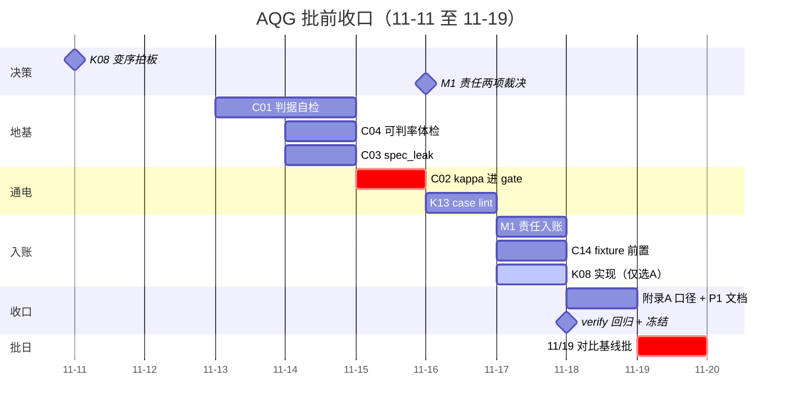

# AQG 批前每日排期（11-11 → 11-19）

> **依据**：[`00-待做优先级.md`](00-待做优先级.md) 的 P0×9 与 P1×6，全部须在 11/19 对比基线批开跑前收口。
> **硬约束**：11-12 整天不排（预留日）；禁止为过门禁放宽断言；不为单项单独开切代窗口。
> **基线**：commit `3caa778` / `core_suite` epoch `deff7501007cff61`（207 条）/ 最新批次 `20261106-night`。
> **用法**：每天收工前核对当日"出口标准"，做到就打勾；任何一天掉队，按 §五 裁剪顺序执行，不临场纠结。

---

## 一、K08 变序时机 —— 决策记录位（11-11 拍板）

> 这是 49 项里唯一时机比工作量重要的决策。变序不改 `core_suite` 指纹、不触发切代，
> 但会让"重复采样同序 → jaccard 恒 1.0"这个已知虚假稳定失效——当前稳定性数字**偏乐观**。

| 选项 | 后果 | 追加成本 |
|---|---|---|
| **A. 11/19 批前实现** | 损失一次重跑（那批本来就是第一个基线）；批起数字即真实 | 0.5 天实现 + 冒烟重跑，落在 11-17 晚 |
| **B. P2 窗口实现** | 11/19 批沿用同序，口径声明须写明 jaccard 偏乐观；之后重跑损失两个基线的可比性 | 0（批前），并入 P2 |

**决策：☐ 待定**（拍板后填写 A/B、理由与日期；选 A 则 11-17 追加条目生效）

---

## 二、逐日计划

### 11-11（周三）今晚 ｜ 决策夜 —— 不动代码

- [ ] 你：拍板 §一 K08 决策（A/B），填回记录位
- 出口标准：K08 有明确结论并记入本文

### 11-12（周四）⛔ 不排

- 全天预留（休息/缓冲）。任何突发只允许记进本表，不允许占用后续日的既定内容。

### 11-13（周五）Day 1 ｜ 地基日：裁判回路

- [ ] 我：**C01 判据自检** 设计 + 实施第 1 天——用 `positive_reference`／`negative_reference` 离线回喂裁判，输出区分度矩阵；配套单测
- [ ] 你：`labels.jsonl` 标注**前 20 条**（分层抽样，约 1 小时）——它是 11-15 C02 的唯一前置依赖
- 出口标准：C01 核心逻辑跑通出中间结果；20 条标注在手

### 11-14（周六）Day 2 ｜ 三小项打包日

- [ ] 我：C01 收尾并入 `verify.py`
- [ ] 我：**C04 可判率 + 重复率体检**（0.5 天，与 C01 同一套离线机器，绑定 target）
- [ ] 我：**C03 `spec_leak`** 检查（0.5 天，机器验证"判据没漏给被测"这一从未验证的前提）
- [ ] 你：`labels.jsonl` 标注**后 20 条**——**硬截止：今天封账**，否则 11-15 断粮
- [ ] 你：审附录 A 映射表草案（RESTRICTED vs S2 脱敏上云 的口径）
- 出口标准：C01／C03／C04 全部带单测、离线报告出数；40 条标注封账

### 11-15（周日）Day 3 ｜ κ 通电日

- [ ] 我：**C02 κ 权限表进 gate**（1 天）——`calibrate_judge.py:81` 的 `cohens_kappa` 已实装，先跑标定出实测 κ，再接入 `gate.py` 的 blocked 判据；配套单测
- [ ] 我（余力）：K13 case lint 设计稿，供 11-16 直接开工
- 出口标准：gate 引用实测 κ，"哪些指标有权拦发布"不再是借来的阈值

### 11-16（周一）Day 4 ｜ lint + 责任决策日

- [ ] 我：**K13 case lint** 实施（1 天）——新增 `scripts/lint_cases.py`，查 207 条用例四问齐备性，warning 级起步接入 `aqg-ci`
- [ ] 你：**M1 责任入账两项裁决**——`owner` 字段填谁、`risk_accepted_by` 谁有资格签名（只能你定，11-17 开工要用）
- 出口标准：lint 对 207 条出齐备性报告（零警告或列出待修清单）

### 11-17（周二）Day 5 ｜ 入账 + 前置校验日

- [ ] 我：**M1 台账补 `owner`／`risk_accepted_by`**（1 天：schema → 落账 → 报告，配套单测；ISACA-C1＋K01＋C24 合并项，也是 K14 的落点）
- [ ] 我：**C14′ `fixture_ready` 前置校验**（0.5 天）——跑前确认沙箱 fixture 落盘（`runner.py:354` 注入处），不再等事后归因浪费真机调用
- [ ] 条件项（仅当 K08 拍 A）：**K08 变序实现 + 冒烟重跑**（0.5 天，今晚完成）
- 出口标准：台账每条 open 风险有责任人；fixture 缺失在跑前被摘出；（若选 A）变序冒烟通过

### 11-18（周三）Day 6 ｜ 收口冻结日

- [ ] 我：**附录 A 分级口径冲突**写进 README 映射表（0.5 天：令牌化 vs 脱敏 的口径成文）
- [ ] 我＋你：**P1 六项纯文档**清账——K02 `AGENTS.md`／K03 规约五层登记／K04 已知限制补条／K05 README 引原文／K06 SDD 纪律（occurrences≥2 追问）／K15 confidence 边界写死
- [ ] 我：全量 `verify.py` 回归（单测 + 数据集确定性 + 血缘检查）
- [ ] 我：**11/19 批口径声明成稿**（含 K08 决策结论；若拍 B，须写明"同序重复采样，jaccard 稳定性偏乐观"）
- [ ] 你：环境就绪——`GC_API_KEY`／`ZHIPUAI_API_KEY`／`XHS_API_KEY` 在交互 shell 导出，`models.json` 核对
- [ ] **晚上冻结：P2 起任何改判定的代码不再进入**
- 出口标准：P0×9 全部收口、P1×6 文档清零、verify 全绿、口径声明定稿、环境可用

### 11-19（周四）批日 ｜ 只跑批不改码

- [ ] 跑 7 模型 × 207 条对比基线批
- 纪律：只观察、入账、出报告；任何代码修改进入下一个窗口

---

## 三、执行节奏总览

> 11-12 预留日在图上为空白，是故意的：它不属于任何环节，只用于吸收上游突发。

---

## 四、标注工作量明细（`labels.jsonl` 40 条）

| 批次 | 日期 | 条数 | 说明 |
|---|---|---|---|
| 第一批 | 11-13 | 20 | 分层抽样：按 `category` × `risk_level` 覆盖 |
| 第二批 | 11-14 | 20 | 当日封账，C02 硬依赖 |

标注口径：对每条用例人工给出 pass/fail 二值裁决（与裁判同判据），供 κ 计算。具体格式以 C01 实施时一并定稿。

---

## 五、掉队裁剪顺序（提前约定）

| 序 | 规则 | 理由 |
|---|---|---|
| 1 | **K13 可砍到最小版**（只查四问字段存在性） | 持续防退化机制，批前非刚性 |
| 2 | **C04 可顺延进 P2** | 掉队时在口径声明写"可判率体检待补"，比硬塞安全 |
| 3 | **C01 绝不可砍** | 它塌了整批分数不可引用，其余 8 项都是它的注脚 |
| 4 | K08 选 A 但 11-17 晚实现未完 → **自动退回 B** | 不挤占收口日；口径声明按 B 文案写 |

---

脚注：本文各任务的技术定义与锚点以 [`00-待做优先级.md`](00-待做优先级.md) 为准（其中 §九 更正记录 7 条已同步进两份来源清单）；本文只补充日期、执行人与出口标准。gantt 图语法经 mermaid ≤8.8.3 校验。
