# StartLux RSI 分享 · 脑图

> 出处：《RSI 的技术探索：从实践经验到系统设计》，郭权玮（Startlux 联合创始人兼 CTO、语生科学首席科学家），议程时段 14:20–15:40。
> 来源材料：现场照片 5 张（议程表 1 张 ＋ Figure 2 自进化闭环 2 张 ＋ Figure 4 整体评测 1 张 ＋ Figure 5 模块归因 1 张）。
> **引用纪律**：讲者在页脚声明「全页数字为计算示例，非 StartLux 实测结果」，本图所有数值一律按**未独立核验**处理，只可引定义与结论句，不可引数字对外（AGENTS.md 纪律 6）。讲者姓名与职务取自议程表，未向主办方二次核验。

## 一、脑图

```mermaid
graph TD
  ROOT["StartLux RSI 技术探索"]

  ROOT --> A["自进化闭环"]
  ROOT --> B["评测实践一：整体效益与版本迭代"]
  ROOT --> C["评测实践二：异构模块贡献与优化"]
  ROOT --> D["口径与红线"]
  ROOT --> E["分享出处"]

  E --> E1["议题：RSI 的技术探索 从实践经验到系统设计"]
  E --> E2["讲者：郭权玮，Startlux 联合创始人兼 CTO"]
  E --> E3["议程时段 14:20 到 15:40"]

  A --> A0["Research Council：每一步只唤起真正需要的角色"]
  A --> A1["01 OBSERVE：真实任务失败，抓失败轨迹与约束冲突"]
  A1 --> A11["真实任务不是数据源，而是研究问题的起点"]
  A1 --> A12["归因分流：数据、推理顺序、工具使用、reward 设计、系统问题"]
  A1 --> A13["约每 6 小时做一次阶段 review，8h 为当前工程节奏非算法必要条件"]
  A1 --> A14["失败归因链：向量召回、关系排序、quarantine、ablation、shadow retain"]
  A --> A2["02 DECIDE：多解释到候选假设，按收益不确定性成本选实验"]
  A --> A3["03 BUILD：数据与实验工厂，lineage 加 Research Memory"]
  A --> A4["04 TRAIN：并行候选训练，SFT 或 RL 或自蒸馏"]
  A --> A5["05 EVALUATE：目标任务加通用回归加 unseen holdout 加成本时延"]
  A --> A6["06 GATE：多目标约束，Promote 或 Quarantine 或 Rollback"]
  A --> A7["07 DEPLOY：本地部署验证，结果回流下一轮"]

  B --> B1["共同起点 S0：任务模型、记忆快照、任务包与环境一致"]
  B --> B2["R0 现行完整 RSI 对 R1 单模块候选配置"]
  B --> B3["等预算看能力增益，等目标看算力消耗"]
  B --> B4["整体收益加 12pp 与 配置改动系统增益加 4pp 分别记账"]
  B --> B5["每轮配对复跑，冻结版本后另做封存盲测"]

  C --> C1["01 固定输入回放：定位提案、预测、决策、归因的差异"]
  C --> C2["02 单模块替换整轮重跑：其余模块与预算规则固定"]
  C --> C3["03 整体验收：保留或回退，形成下一版本"]
  C --> C4["四角色四问"]
  C --> C5["交互项：四格对照，MAE 下降不等于排序改善"]

  C4 --> C41["Hypothesis：可执行率 80%，有效假设率 40%"]
  C4 --> C42["Predictor：新旧对照，样本独立回放不参与训练调参"]
  C4 --> C43["JEV：固定 JEV 换规则 对 固定规则独立判 Gate"]
  C4 --> C44["GNN：干预验证命中率 20% 到 40%"]

  D --> D1["页脚声明：数字为计算示例，非实测结果"]
  D --> D2["单模块先过程检验，再按协议验整轮收益"]
  D --> D3["多目标约束，不用总分互相抵消"]
  D --> D4["环境故障剔出分母，不计入模型能力"]

  classDef root fill:#1e3a8a,stroke:#1e3a8a,color:#ffffff,font-weight:bold
  classDef branch fill:#dbeafe,stroke:#1e40af,color:#1e3a8a
  classDef leaf fill:#f8fafc,stroke:#cbd5e1,color:#0f172a
  classDef warn fill:#fef3c7,stroke:#b45309,color:#7c2d12
  class ROOT root
  class A,B,C,D,E branch
  class D1,D3,D4 warn
```

## 二、与 AQG 现有设计的对应

| StartLux 提法 | AQG 对应物 | 出处 |
|---|---|---|
| 单模块替换、其余模块与预算固定 | 分层裁判：rule / harness / trajectory / llm 各层单独可判 | `src/engine/judge.py` |
| 环境故障剔出分母 | `precondition_failed` / `UNKNOWN` 不计入模型能力分母 | `src/engine/failure_class.py`、纪律 3 |
| 多目标不互相抵消、safety=PASS 是硬条件 | Strict / Standard 双轨，发布门禁用 Strict | `src/engine/gate.py`、README「发布门禁」 |
| 干预验证命中率、MAE 降了要复测 Top-k | K08 变序分化：单种子非 0 则稳定性数字不可引用 | `docs/priority-2026q4/01-每日排期.md` K08 条目 |
| 冻结版本后封存盲测 | 代际 `dataset_epoch`：跨代不判劣化，重新基线为 open | CONTRIBUTING「切代约定」 |
